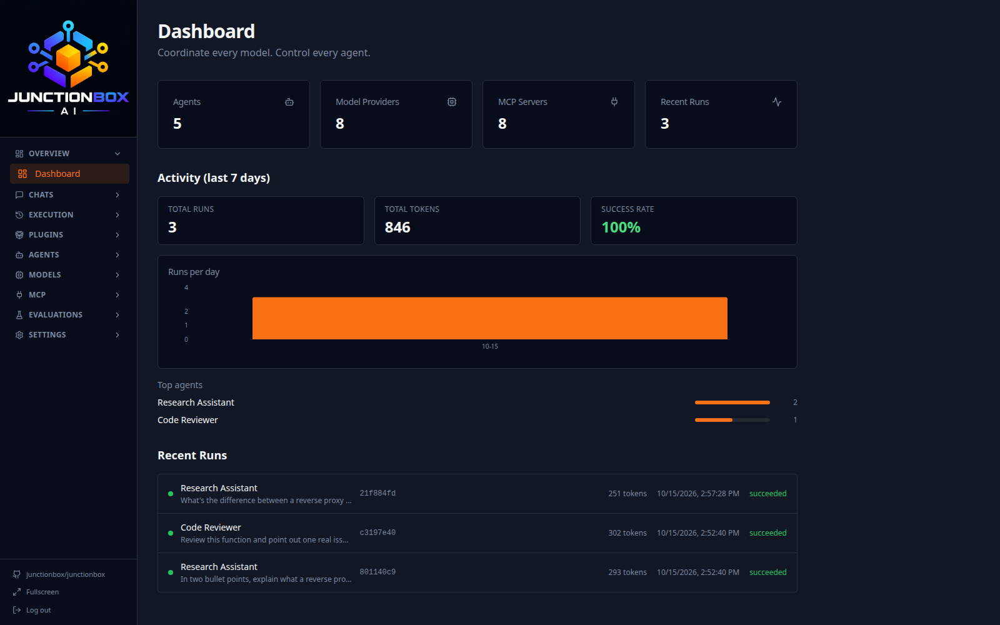

# JunctionBox AI

**Everything connects here.**

JunctionBox is a local-first control plane for your AI work. Run Claude Code, Codex, Grok and local models side by side, put them on teams, schedule them, point them at your own machines, and see everything they do, all from one place on hardware you own. It also turns the TVs in your house into a home screen for your agents, your home and your family.

It runs on **Linux (x86-64), macOS (Apple silicon) and Windows (64-bit)**. The core is **free** for up to two active agents. Pro is **$49 a year** for unlimited agents.



## What it does

**Agents and models**
- **Use the tools you already pay for.** Create agents that run on your own signed-in Claude, Codex or Grok command-line tools, with no separate API key or API billing needed for those.
- **Or connect APIs and local models.** Anthropic, OpenAI and xAI API keys work too, and so do local or remote Ollama and llama.cpp servers.
- **Mix them freely.** One team can hold a Claude agent, a Codex agent, a Grok agent and a local model, and you can compare their answers to the same question side by side.
- **Local AI on your own hardware.** JunctionBox measures your computers, recommends models that really fit, installs them and tests what they can do. After that they work with no internet. See [`docs/LOCAL_AI.md`](docs/LOCAL_AI.md).

**Work that keeps going**
- **Teams.** Organize specialized agents into teams that can hand work to one another within boundaries you set.
- **Durable runs.** Jobs continue when the browser closes and survive restarts.
- **Schedules, webhooks and Telegram.** Run agents on a timer, from a webhook, or from a chat message.
- **Memory.** Optional identities, profiles and approved memories give agents lasting context.

**Machines and tools**
- **Boxes.** Run agents on your other Linux, macOS and Windows machines, open terminals on them, and share their screens.
- **MCP tools.** Install and manage MCP servers and give their tools to your agents.
- **Plugins.** Add new abilities without touching the core, or build your own (see below).

**Control and visibility**
- **Sandboxed on Linux and macOS**, with permission profiles, team visibility limits, review of privileged operations, and an audit history.
- **Observable.** Live activity, run history, delegated tasks, orchestration graphs, token use, failures and retries.
- **Local by design.** Your database, settings, credentials, run history and memories stay on your machine. Using a cloud model or an outside service sends that service what the operation needs, and only if you configure it.

## On your TV

The **Smart TV Launcher** plugin swaps the usual "which app?" screen for your own home screen on **Roku** TVs and boxes, **Google TV / Android TV** sets and **Fire TV** (Fire OS 7 or newer), with a matching Android tablet launcher. Your streaming apps are still there as big tiles, and the TV returns to the launcher when you leave an app. Around them:

- **The house:** your lights and air conditioning, Ring camera live views with eight picture filters (see Ring Security below), and your Pit Boss grill.
- **Things you made:** your generated videos, photos and books, a watch-later list, and recipes with a video playing beside them.
- **Reading:** seven public-domain Bibles, your own books, and read-aloud.
- **Your agents, on the big screen:** terminals for Claude Code, Codex and Grok on your computer, shells on your other machines, screen sharing you drive with the remote, and a chat with your JunctionBox agents where you watch them work and approve what they ask. All of it sits behind a PIN.
- **Every day:** a Morning Briefing, game schedules for your teams, reminders, a picture frame and music.
- **An arcade you play with the ordinary remote:** Tap Takeover, Stack Attack, Pacific Fury and Junction John: The Lost Circuits, with household top-ten scores and a saved game for Junction John.

Roku support is the most mature. Google TV and Fire TV are newer (the games there have been run in an emulator and not yet on a real Fire TV), so tell us if something runs slowly or looks wrong. Setup for all three is in [`docs/SMART_TV_LAUNCHER.md`](docs/SMART_TV_LAUNCHER.md).

## Plugins

JunctionBox is built to be extended. A plugin is a small package with its own sidebar page, its own backend and, if it wants, tools your agents can call. Install one from **Settings → Plugins → Browse for plugin ZIP**; each is attached to the [latest release](../../releases/latest). There is no marketplace or review step, and the **Plugin Builder** will scaffold a correctly structured package for you to fill in. The format is in [`docs/JUNCTIONBOX_PLUGIN_CONTEXT.md`](docs/JUNCTIONBOX_PLUGIN_CONTEXT.md). The 25 plugins available today:

**Home and TV**
- **Smart TV Launcher**: the Roku, Google TV and Fire TV home screen above.
- **Home Control**: lights, plugs and air conditioning across protocols, with rooms, groups and schedules.
- **Ring Security**: your Ring doorbells and cameras, with live view, snapshots, event history and recordings. On the TV, a live view has eight picture filters you cycle with Play/Pause: Night green, Night red, Low light, Contrast, Heat map, Edges, Motion map and Motion trails. They enhance or recolor what the camera sends and are not real infrared or thermal vision. A Pro feature, included in the 7-day trial.
- **Pit Boss Grill**: watch and control a Pit Boss WiFi grill over your home network, no cloud account.
- **TV Player**: one-click tiles for YouTube, Netflix, Hulu and other streaming sites, in a real browser window.
- **Watch List**: a shelf of videos to watch later, shown on your TV.
- **Recipes**: your recipes as you write them, with a big-text cook view.

**Create**
- **Video Studio** (with **Movie Maker**): text-to-video and whole movies from short shots.
- **Comic Studio**: comic strips with characters, panels, balloons and print-ready books.
- **Book Studio**: write and publish books, imported from Word or PDF, exported as screen and print PDFs.
- **Storyboard**, **Stickers**, **Age Shift**, **Time Machine** and **Image Finish**: image tools for concept art, a sticker library, apparent-age changes, "old photograph" restorations of buildings, and simple local touch-ups.
- **Print Studio**: 3D-printable models, exact or from a photo or description.

**Research**
- **AI Image Detector**: checks whether an image is AI-generated, and shows why.
- **Historical Intelligence**: a research database and team for old buildings and their stories, with every claim tied to a quoted source.
- **DeviceLab**: a workspace for reverse engineering hardware and software you own or may analyze.

**Communication**
- **iMessage Chat**: a full Messages client through your own Mac.
- **Slack Desktop**: drive your own Slack app on a remote machine.
- **iCloud Mail**: review and clean up spam, subscriptions and old mail, one batch at a time.

**Infrastructure and browsing**
- **Kubernetes**: create and manage disposable clusters on your machines.
- **SubBrowser** and **HomeBrowser**: a real isolated browser streamed into JunctionBox, one through Tor and one persistent.

More detail on each is in [`docs/PLUGINS.md`](docs/PLUGINS.md).

## Download and install

Download the archive for your system from the [latest release](../../releases/latest). You do not need Python, Node.js or any other runtime.

**Linux and macOS** (download the `linux-x86_64` or `darwin-arm64` archive)

```bash
tar -xzf junctionbox-*.tar.gz
cd junctionbox-release
./install-services.sh
```

**Windows** (64-bit, Windows 10, 11 or Server 2019 and newer; no administrator rights needed). Unzip the release, open PowerShell in the folder and run:

```powershell
powershell -ExecutionPolicy Bypass -File .\install-services.ps1
```

The installer sets JunctionBox up as background services that start when you log in. Then open **http://127.0.0.1:8000** on that same computer and set your password. Nothing works until you do, and setup can only be finished from the computer JunctionBox is on.

A few things to know:
- **Linux** needs a systemd user session (the default on desktop distributions). **macOS** needs nothing extra.
- The programs are not code-signed yet, so macOS and Windows may show a security warning the first time. On Windows, choose **More info**, then **Run anyway**.
- On **Windows** there is no agent sandbox equivalent to the Linux and macOS ones, so local agents run with your own account's rights. Settings says so next to the permission profile.
- Everything JunctionBox stores lives under `~/.junctionbox/` (`%USERPROFILE%\.junctionbox` on Windows). Uninstalling keeps it unless you tell it not to.

The full install, update, service-management, troubleshooting and removal instructions are in the `README.md` inside every release archive.

## Free and Pro

| | Free | Pro |
|---|---|---|
| Active agents | 2 | Unlimited |
| Price | $0 | $49 a year |

Both editions are the same application. Pro removes the agent limit; it does not move anything to a hosted service. Free needs no account, no payment and no network call. To upgrade, use **Settings → License → Upgrade to Pro** in the app (a Stripe-hosted checkout), then paste the activation code into **Activate Pro**. Cancel from **Manage Subscription** and Pro stays active until the end of the period you paid for.

## Documentation

| | |
|---|---|
| [`docs/USER_GUIDE.md`](docs/USER_GUIDE.md) | Day-to-day use: agents, chat, teams, scheduling, memory, administration |
| [`docs/VISUAL_GUIDE.md`](docs/VISUAL_GUIDE.md) | A screenshot tour of the main features |
| [`docs/FEATURES.md`](docs/FEATURES.md) | What JunctionBox can do, at a glance |
| [`docs/LOCAL_AI.md`](docs/LOCAL_AI.md) · [`docs/LOCAL_AI_MANAGER.md`](docs/LOCAL_AI_MANAGER.md) | Finding, installing and testing models on your own hardware |
| [`docs/SMART_TV_LAUNCHER.md`](docs/SMART_TV_LAUNCHER.md) | The TV launcher and games: setup for Roku, Google TV and Fire TV |
| [`docs/PLUGINS.md`](docs/PLUGINS.md) | The optional plugins |
| [`docs/JUNCTIONBOX_PLUGIN_CONTEXT.md`](docs/JUNCTIONBOX_PLUGIN_CONTEXT.md) | The plugin format, for writing your own |
| [`docs/DEPLOYMENT_SECURITY.md`](docs/DEPLOYMENT_SECURITY.md) | Reaching JunctionBox from other devices safely |
| [`docs/EULA.md`](docs/EULA.md) · [`docs/PRIVACY_POLICY.md`](docs/PRIVACY_POLICY.md) · [`docs/THIRD_PARTY_NOTICES.md`](docs/THIRD_PARTY_NOTICES.md) | Legal |

## Feedback

Found a bug or want something added? Use **Report a bug or suggest a feature** at the bottom of the sidebar in JunctionBox, or the form on the contact page at [junctionboxai.com](https://junctionboxai.com). Nothing is sent from the app until you press Send, and you see exactly what it includes first.

## About this repository

This repository holds **downloads and documentation only**. JunctionBox is closed-source commercial software, distributed as pre-built binaries on the [Releases](../../releases/latest) page. Installing or using it means you agree to the [EULA](docs/EULA.md) and the [privacy policy](docs/PRIVACY_POLICY.md).

---

**JunctionBox AI** · *Everything connects here.*
