# Smart TV Launcher: your own home screen on your Roku, Google TV and Fire TV sets

Smart TV Launcher puts a custom home screen on your Roku TVs and boxes, and on Google TV, Android TV and Fire TV sets. It shows your streaming apps as big tiles, the weather, and a row of JunctionBox controls: your lights and air conditioning, your Ring cameras, your generated videos and photos, your books and Bibles, and terminals for the Claude, Codex and Grok coding agents on your computer, plus shells on your JunctionBox boxes and screen sharing of them. When you leave an app, the TV comes back to it by itself.

**Where it runs.** JunctionBox runs on Linux, macOS and Windows (and can manage Windows, Linux and macOS machines as boxes). The Smart TV Launcher's bridge runs on that same computer, and the launcher itself runs on Roku TVs and boxes, on Google TV / Android TV sets, and on Fire TV (Fire OS 7 or newer). Fire TV support is built and tested against a stand-in for the device but has not yet been run on a real Fire TV.

It has two parts, and the **Smart TV Launcher plugin** sets up both:

- **The TV app**, a small app installed on each TV: a sideloaded app on a Roku (in developer mode), or a small Android app on a Google TV.
- **The bridge**, a small background program on the computer that runs JunctionBox. The TV app asks the bridge for weather, camera pictures, your photos and so on, and the bridge sends the launcher back to the screen when you exit an app.

Nothing here goes through Roku's channel store, and nothing leaves your home network except the weather lookup (Open-Meteo and the US National Weather Service).

## What it looks like

These pictures are of the real launcher on a TV, showing made-up demo data (no real boxes, photos or cameras).

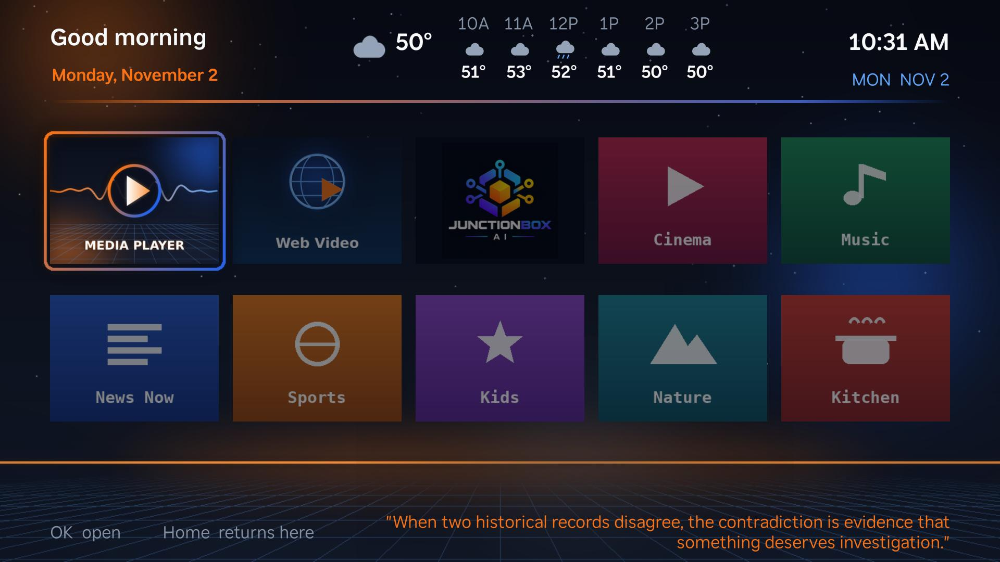

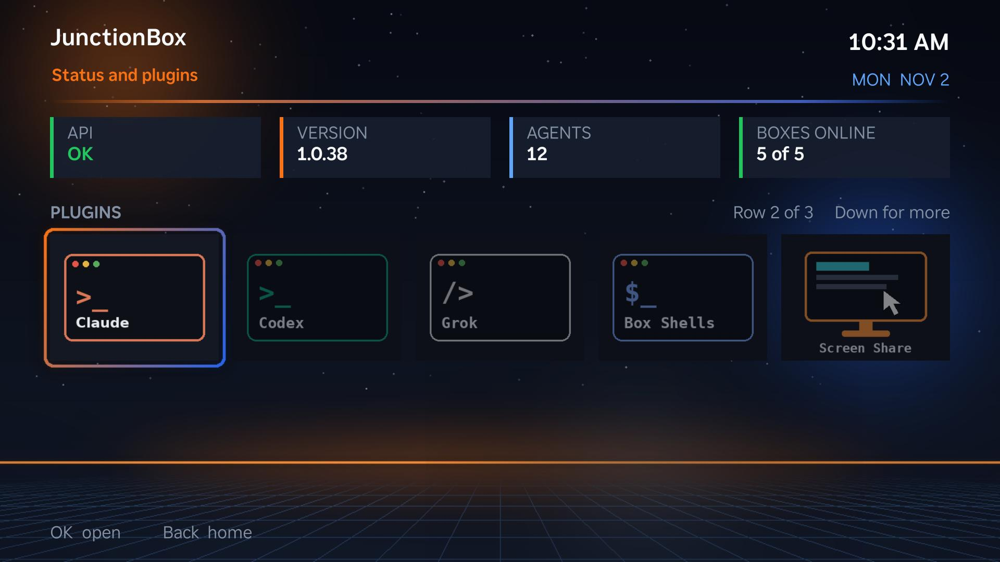

| | |
|---|---|
| 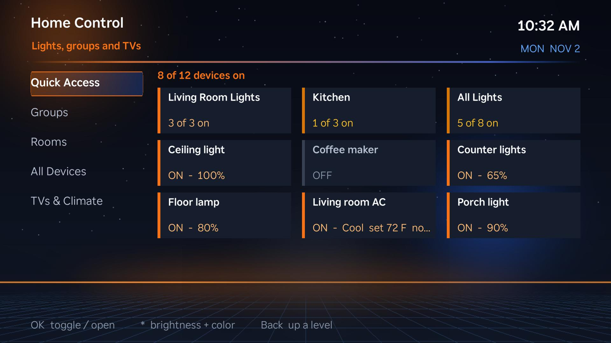 | 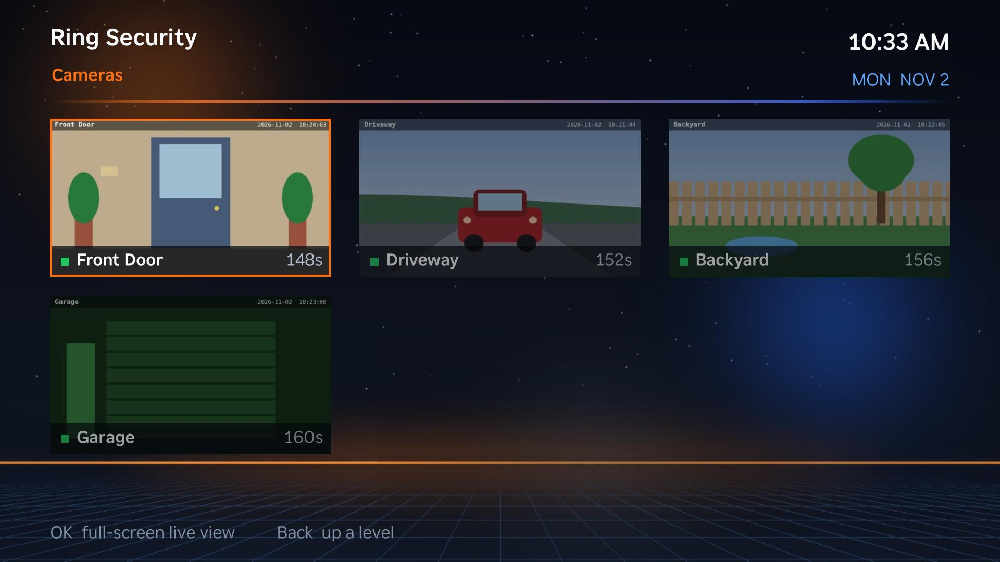 |
| 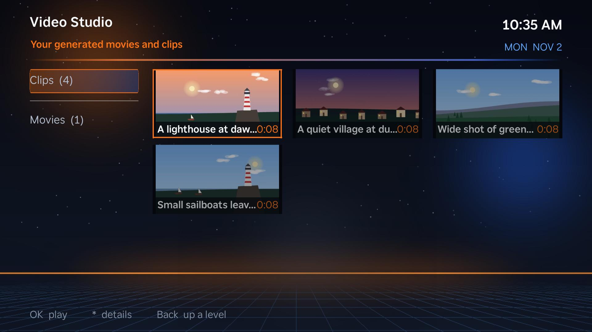 | 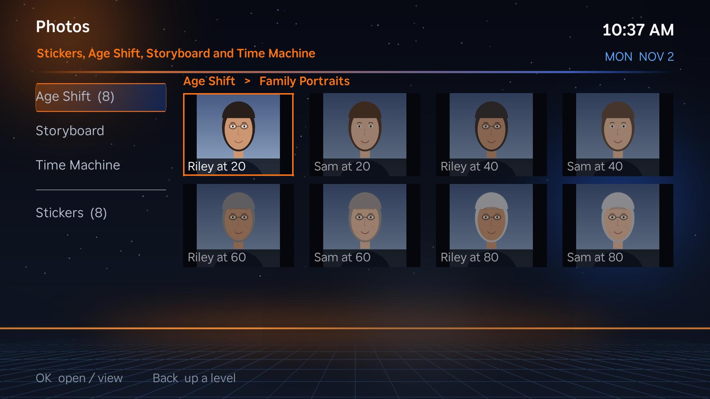 |
| 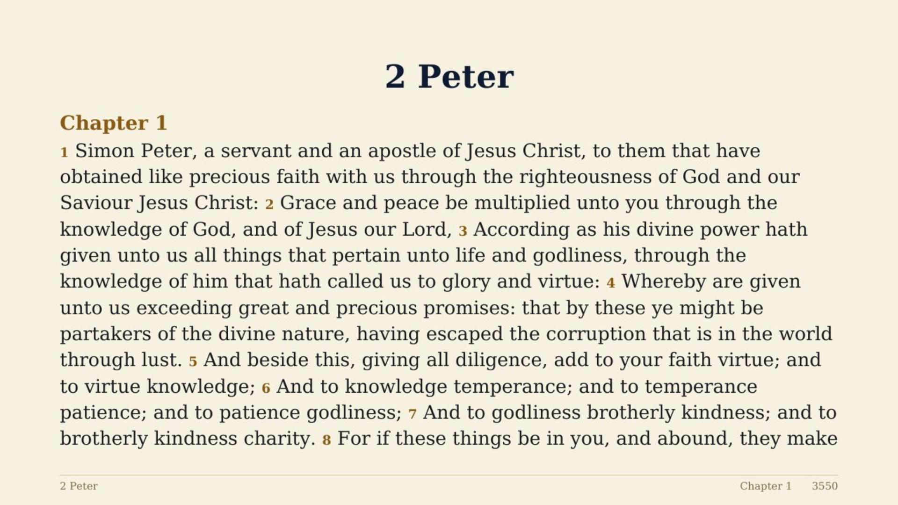 | 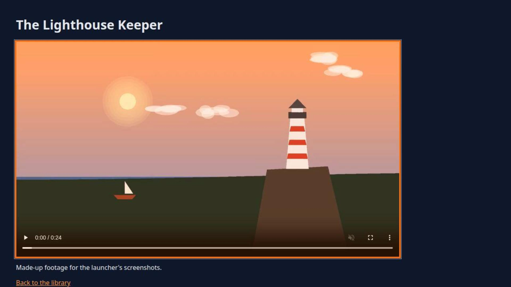 |
| 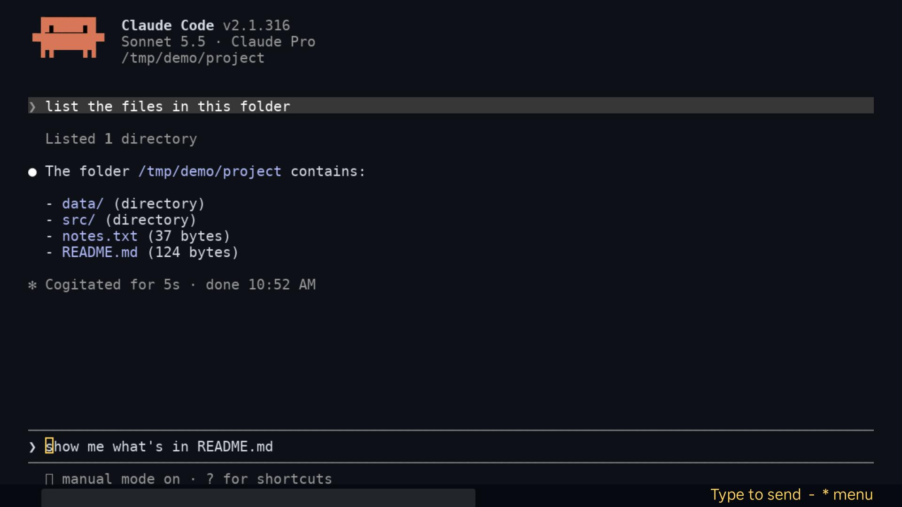 | 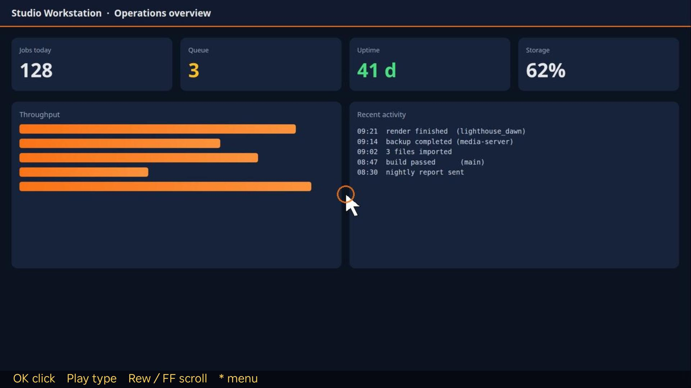 |

## What you need

- JunctionBox running on a computer that stays on (Linux, macOS or Windows). The bridge runs on the same computer, as your own user, and must be on whenever you want the launcher to work.
- One or more Roku TVs or boxes, and/or Google TV or Android TV sets, on the same home network as that computer.
- Python 3.9 or newer with the `venv` module on that computer. Ubuntu and Debian: `sudo apt install python3 python3-venv`. macOS: `brew install python`. Windows: nothing to do first. If there is no Python 3.9 or newer, the bridge set-up downloads and installs a per-user Python 3.12 for you (no administrator rights).
- Optional, for specific features:
  - **ffmpeg**, for Ring live view, the Web Video fallback player and the Morning Briefing. Windows: `winget install Gyan.FFmpeg`.
  - **poppler** (`pdftoppm`), for reading Book Studio and Comic Studio PDFs and Bibles on the TV. Windows: `winget install oschwartz10612.Poppler`.
  - **Claude Code** (`claude`), **Codex** (`codex`) and/or **Grok** (`grok`), signed in on the computer, for the terminal tiles. Only the ones you have get a working tile.
  - **Google Chrome**, for Web Video (Roku only). Without it the plugin downloads a browser for you.
  - **adb** (Android's debugging tool), for Google TVs and Fire TVs only. The plugin downloads Google's copy for you (about 12 MB) if you don't have it.

## Step 1: Get each TV ready

Do this once on every TV you want the launcher on. It doesn't void the warranty and doesn't change how the TV works. It only lets you install apps from your own computer.

### Roku: turn on developer mode

1. Turn the Roku on and go to its **Home** screen.
2. On the remote, press these buttons, fairly quickly and in this order:

   **Home, Home, Home, Up, Up, Right, Left, Right, Left, Right**

3. The **Developer Settings** screen opens. Write down the **IP address** it shows.
4. Choose **Enable installer and restart**, then accept the license agreement.
5. Choose a **webserver password**. Pick something simple and unique; you'll type it into JunctionBox, and it's only used on your home network. Write it down.
6. The Roku restarts. Developer mode is now on, and it stays on after restarts.

If the key sequence does nothing, check that the Roku is on its Home screen (not inside an app), then try again a little slower.

**One app slot.** A Roku can have only one sideloaded ("dev") app. Installing the launcher replaces any other app you sideloaded before.

### Google TV or Android TV: turn on wireless debugging

1. Open **Settings, System, About** and press **Build** (or **Android TV OS build**) seven times, until it says you are a developer.
2. Open **Settings, System, Developer options** and turn on **USB debugging** and **Wireless debugging**.
3. In Wireless debugging choose **Pair device with pairing code**. The TV shows a six-digit **code** and an address with a **pairing port**. Leave that screen open; you'll type them into JunctionBox in step 3. The code expires in a minute or two.

Pairing lets this computer install and open apps on the TV. You can take that permission back under Developer options, **Revoke wireless debugging authorizations**.

### Fire TV: turn on ADB debugging

1. Open **Settings, My Fire TV, About** and press **OK** on the device name seven times, until it says you are a developer.
2. Go back to **My Fire TV** and open **Developer options**. Turn on **ADB debugging** and **Install unknown apps** (on newer software the second switch is under each app).
3. Note the TV's address under **Settings, My Fire TV, About, Network**. You'll type it into JunctionBox in step 3.

There is no pairing code. The first time this computer connects, the TV asks **Allow USB debugging?**; tick **Always allow from this computer** and choose **OK**. Take the permission back under Developer options, **Revoke USB debugging authorizations**. Needs Fire OS 7 or newer: Fire TV Stick 4K and newer, Fire TV Stick Lite, Fire TV Cube (2nd generation and newer) and Fire TV sets. Older Fire OS 5 and 6 devices are too old for the launcher app.

### Give each TV a fixed address

The launcher finds each TV by its IP address, so it must not change. In your router's settings, find "DHCP reservation", "address reservation" or "static lease", pick each TV from the list of connected devices, and reserve its current address. Do the same for the computer that runs JunctionBox, because the TV apps are built with that computer's address. If a TV or the computer ever changes address, update it in the plugin and press **Install** again on each TV.

## Step 2: Install the plugin

1. In JunctionBox, open **Settings, then Plugins**.
2. Choose **Browse for plugin ZIP** and pick `smart-tv-launcher.zip` (it's attached to each JunctionBox release).
3. Restart JunctionBox when asked. **Smart TV Launcher** appears in the sidebar.

## Step 3: Use the setup page

Open **Smart TV Launcher**. The page has six numbered cards.

### 1. Get each TV ready

The two sets of steps above, so you can keep this page open at the TV.

### 2. Start the bridge

Press **Set up the bridge**. The plugin does everything for you and shows its progress:

1. copies the bridge program to `~/.roku-launcher/runtime`,
2. builds a private Python environment for it (it never touches your system Python),
3. installs the libraries it needs (Pillow for pictures, pyte for the terminal screens),
4. registers it as a background service that starts when you log in (systemd on Linux, launchd on macOS, a per-user Scheduled Task on Windows), and starts it.

When the page shows **Running**, the bridge is up. It lists **optional parts**:

| Part | What it adds | Notes |
|---|---|---|
| Ring live view | Live video and audio from your Ring cameras on the TV | Large download. Needs ffmpeg. |
| Web Video (Roku) | A browser on your computer that you steer from the TV remote, with the video handed to the TV's own player | Needs Google Chrome or a downloaded browser. |
| ffmpeg | Re-streaming video | Install with your package manager (Windows: `winget install Gyan.FFmpeg`). |
| pdftoppm | Reading Book Studio and Comic Studio PDFs | Install `poppler` (Windows: `winget install oschwartz10612.Poppler`). |

Install the ones you want. You can add them later. Anything missing is simply unavailable on the TV; the rest keeps working.

### 3. Your TVs

One list holds every TV, with a badge for its kind.

**To add a Roku:** press **Find Rokus on my network** (or choose **Roku** in **Add a TV** and type its address), enter the developer password, and press **Add TV**. The plugin checks that the Roku is reachable, that developer mode is on, and that the password is accepted.

**To add a Google TV:** choose **Google TV / Android TV** in **Add a TV**. If adb isn't ready, press **Get adb**. Enter the TV's address and a name, then the **pairing port and code** from the TV, and press **Pair and add**. Pairing happens once. After that the plugin finds the TV's debugging port by itself, even though that port changes every time the TV restarts its debugging. If this computer is already paired with the TV, leave the pairing boxes empty.

**To add a Fire TV:** choose **Fire TV** in **Add a TV**, enter its address and a name, and press **Connect and add**. If the TV asks to allow this computer, accept it with **Always allow** and press the button again. The plugin checks that the device really is an Amazon Fire TV.

**Install:** press **Install** on a TV's row. The launcher is built for your installation (your computer's address and a private key are put into it) and sent to the TV, which opens it right away. **Install or update on all TVs** does every TV at once. After a JunctionBox update brings a newer launcher, each row shows **Update available**; press **Update**.

The key is a random token created on your computer, stored only in `~/.roku-launcher/token` (readable only by you) and inside the app on your TVs. The bridge ignores requests without it.

**Google TV: make it the Home screen.** When you like how the launcher looks on a Google TV, press **Make it the Home screen** on its row, so the Home button opens it. **Restore Google Home** puts things back at any time, and removing the TV can also delete the app and restore Google's Home screen. The plugin checks that the TV accepted the change. Some Android 14 Google TVs accept the setting but keep sending the Home button to Google's own home app; for those the plugin also switches Google's home app off (`pm disable-user`), which makes the Home button open the launcher, and **Restore Google Home** switches it back on. While it is off, the launcher's *Go to the Google TV home screen* does nothing, so use **Restore Google Home** first. If a TV refuses both, the launcher still works as an app you open from the app row.

**Fire TV: how the launcher stays in front.** Amazon doesn't let any app become a Fire TV's Home screen, so there is no Home-screen button for a Fire TV. Instead the bridge watches it over adb (every two seconds, only while it is awake) and, when Amazon's home screen comes up, opens the launcher again, just as it does for a Roku. You see Amazon's screen for a second or two after pressing Home, then the launcher. To leave on purpose, use the launcher's **Settings**: *Go to the Fire TV home screen* and *Fire TV settings* tell the bridge to stand down for 10 minutes first. A TV that goes to sleep and wakes up starts being watched again. A Fire TV has its own app tiles (the same services use different package names there); on install the plugin makes the list from what the TV really has, and **Apps on Google TV and Fire TV tiles** in step 4 changes it. The bridge must be running and able to reach the TV for this to work. The launcher app is version 1.1.4.

**Home Control.** Every Google TV and Fire TV you add is also registered in Home Control (when that plugin is installed) so you can switch it on and off there: off sends the sleep key over adb; on sends a Wake-on-LAN packet to the TV's Wi-Fi address (saved when the TV was added) and, if the TV is reachable, a wake key. A TV in deep sleep may not answer on the network; a Fire TV usually stays reachable, a Google TV depends on its "wake on Wi-Fi / Cast" setting. Removing the TV removes it from Home Control too.

### 4. Choose what the home screen shows

- **Weather location**: search for your town and press **Use**.
- **Apps on the home screen** (Roku): press **Pick from this TV's apps** to list the channels actually installed on a Roku, tick the ones you want as tiles, put them in order with the arrows, and press **Save apps**. Tile pictures come from the TV itself.
- **Apps on Google TV tiles**: the same, from a Google TV's installed apps. Tiles for apps that aren't installed on a particular TV are hidden on that TV.
- **Quotes**: the line at the bottom of the home screen (Roku and Google TV). Type your own, one per line, and press **Save quotes**. Until you do, the TVs show a standard set of short, neutral lines. **Use the standard set** puts them back, and unticking **Show a quote** hides the line on every TV (your list is kept). Repeats and blank lines are dropped, a quote can be up to 240 characters, and you can keep up to 500. A TV picks up changes within a few minutes of its next refresh, or the next time the launcher opens.

Other changes show up the next time the launcher opens on the TV.

### 5. Bibles to read on the TV

The launcher comes with seven public-domain Bibles: the King James Version, American Standard Version (1901), Douay-Rheims (with the deuterocanonical books), Catholic Public Domain Version, World English Bible, an **Ethiopian Bible in English** (with the extra books: Enoch, Jubilees, Meqabyan and others) and an **Amharic Bible** (አማርኛ). Tick the ones you want and press **Build**. Each becomes a PDF on this computer (about a minute or two each, 2,000 to 4,000 pages, 4 to 6 MB) and shows up in **Books** on every TV.

Reading a Bible on the TV:

- **Contents.** Press **OK** on Google TV, or **\*** on a Roku and choose *Contents*. Pick **Old Testament** or **New Testament** (Bibles that include extra books also have **Apocrypha and extra books**), then a book. The book opens at chapter 1.
- **Chapters.** In the same menu, *Chapters of this book* lists every chapter of the book you are in (on Google TV press **Menu**).
- **Study guides.** Many New Testament books open with a study guide (author, date, purpose, background, themes, key passages, structure and application) before chapter 1. In the chapter list it appears as **Study guide**, ahead of Chapter 1. It is laid out as its own pages: a title, the key facts, then each section under a gold heading with numbered lists, bullets and quotations, and no verse numbers.
- **Back** steps up one level. The TV remembers the page you were on for each Bible.

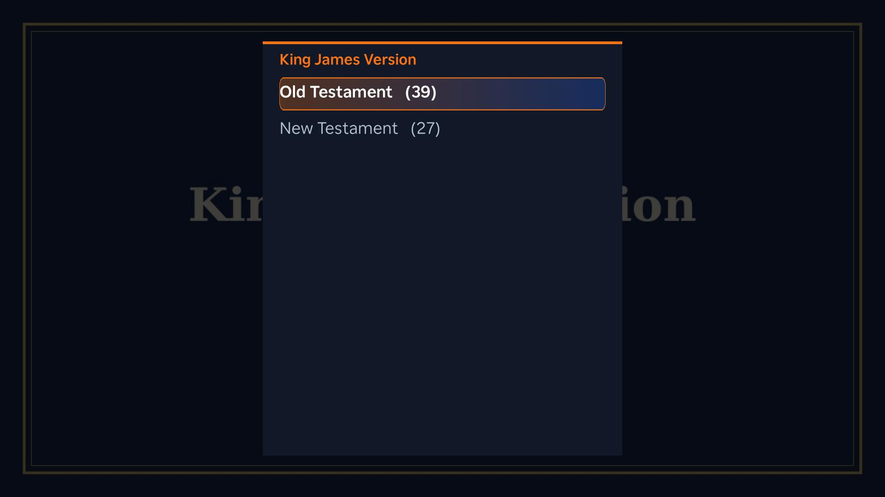

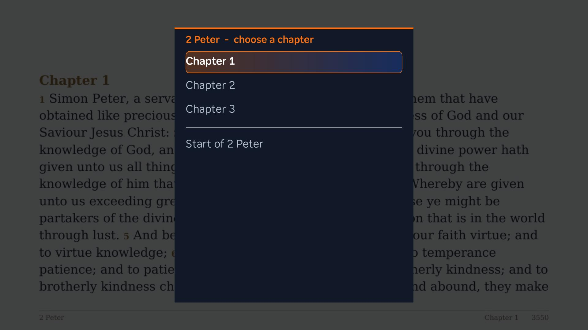

Comic Studio and Book Studio books get a chapter list too (comic books list the strips inside each chapter). The list is saved when a book is built, so books built before it existed show chapters after their next rebuild.

#### Adding your own Bibles

The launcher only turns texts into PDFs; it does not decide which texts you may use. For any other translation you are entitled to use, run the generator that ships with the launcher (`launcher/tools/make_bibles.py`; it needs `pip install reportlab`):

```
make_bibles.py --book ID "Title" "Subtitle" my_bible.json      # {"Genesis": {"1": [{"number": 1, "text": "..."}, ...]}, ...}
make_bibles.py --combined several.json                         # {"KJV": {...}, "ASV": {...}}
make_bibles.py --copy "Some Bible.pdf" some-id "Title" "Subtitle"   # a PDF you already have, used as it is
```

Output goes to the `bibles` folder inside the launcher's data folder (`~/.roku-launcher/bibles`) and appears in Books straight away. A PDF you copy in has no contents until you add a small `<id>.json` beside it: `{"title": ..., "subtitle": ..., "byline": ..., "toc": [{"n": "Genesis", "p": 12, "c": [[1, 12], [2, 14]]}, ...]}` where `n` is the book name, `p` its first page and `c` pairs of chapter and page. Books with a contents list get the Old Testament, New Testament, book and chapter menus; without one a Bible opens as a plain PDF. Pages are exact only when you give exact pages. Amharic and other Ethiopic text is supported (the launcher ships Noto Serif Ethiopic; for your own files pass a font with `--font-ethiopic`). A book can carry a study guide as its chapter `0`: the generator lays it out as described above from lines such as `--- STUDY GUIDE: Title ---`, `AUTHOR: ...`, `--- BACKGROUND ---`, `1. THEME (Chapters 1, 17): explanation`, `• bullet`, `'A quoted verse' (3:16)`. The book list must keep the Bible's order, with the New Testament starting at *Matthew*, so the Old Testament / New Testament buttons come out right.

### 6. Claude, Codex, Grok, box shells, screen share and agents on the TV

Adds **Claude**, **Codex**, **Grok**, **Box Shells**, **Screen Share** and **Agents** tiles to the home screen of every TV, Roku and Google TV. A **Recipes** tile opens your recipes from the separate **Recipes** plugin. Each opens a terminal showing that coding agent running **on the JunctionBox computer**, in your home folder.

**Permissions.** Card 6 has a Permissions drop-down for each agent, so you decide how much it may do without asking. The default for all three is the agent's normal ask-first mode. A choice applies the next time that agent starts (a running session keeps its mode; use **End it** and open the tile again). Modes marked *dangerous* are flagged on the card.

| Agent | Modes |
|---|---|
| Claude | Ask before each action; Edit files freely, ask before commands; Plan only; Automatic; Never ask (allowed tools only); **Do everything, no permission checks** (`--dangerously-skip-permissions`) |
| Codex | Read-only; Edit the home folder, ask for anything else; Automatic review of requests; Work in the home folder without asking; **Do everything, no sandbox, no questions** (`--dangerously-bypass-approvals-and-sandbox`) |
| Grok | Ask before each action; Edit files freely, ask before commands; Plan only; Automatic; Never ask (allowed tools only); **Bypass all permission checks**; **Approve every action automatically** (`--always-approve`) |

In the ask-first modes the agent's questions appear on the TV; answer with the quick keys (1, 2, 3, y, n, Enter). Codex's startup update check is always off so pressing OK can't start an installer. The mode list lives in `launcher/bridge/terminal_modes.json`, and your choices in `term-modes.json` in the launcher's data folder.

**Box Shells** opens a shell on any box JunctionBox knows. Enter the PIN, pick a box from the list, and you get a terminal on it: an `ssh` session using that box's saved key (or its saved password when `sshpass` is installed), or a local shell for the computer JunctionBox runs on. Nothing is typed or stored on the TV; the keys never leave your computer. It works exactly like the agent terminals, with the same quick keys, plus **Back to the list of boxes** in the quick-key menu.

**Leaving it running.** Every terminal, agents and box shells alike, keeps running on your computer when you leave the screen. Close the app, come back later, enter the PIN, and you are in the same session (a box shows *(running)* in the list). **Leave (it keeps running)** in the quick-key menu exits the screen and signs the TV out; **End session** stops it. Card 6 lists running box shells with an **End it** button, and ending is the only thing that closes them (a Mac or Linux box's shell also ends if you type `exit`).

**Screen Share** shows a box's whole screen on the TV and lets you drive it with the remote. It is JunctionBox's own screen sharing (the same thing you open from the boxes page in the web app), viewed through the browser that Web Video uses, so it needs the **Web Video** part from card 2. Enter the PIN, pick a box, and the screen appears; the first time on a box JunctionBox may install its screen server, which can take a minute. Linux, macOS and Windows boxes work as they do in the web app, and the box needs someone logged in at its screen.

- **D-pad** moves the pointer, faster the longer you hold. **OK** clicks. **Rewind / Fast-forward** scroll. **Play** opens the TV's keyboard to type; typing on the Roku phone app's keyboard goes straight to the box.
- **\*** or **Back** opens the menu: right-click, double-click, pick up and drop (drag), **Zoom 2x or 3x** (the view follows the pointer, so small text is readable from the couch), jump the pointer to the middle or a corner, keys (Enter, Escape, Tab, arrows, Delete, Home, End, Page up and down, F5), shortcuts (copy, paste, select all, undo, save, find, Alt+Tab, Alt+F4, the Windows or Command key, Ctrl+Alt+Delete), back to the list of boxes, and **Stop sharing and leave**.
- Unlike a shell, a screen share **does not keep running** when you leave: it ends when you leave the screen, or a minute after the TV stops asking for pictures, and JunctionBox switches the box's screen server off again.
- The screen is redrawn a few times a second, which is fine for browsing and typing but not for video.

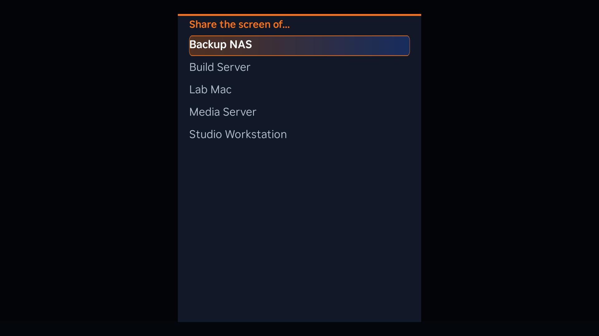


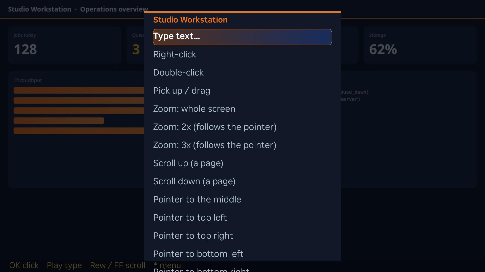

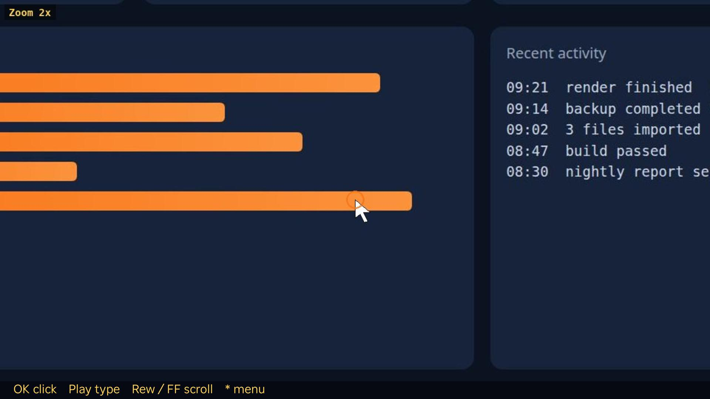

**Agents** is a chat with your JunctionBox agents, from the couch. It is not a terminal: you pick one of the agents you already have in JunctionBox (any provider), talk to it, and watch it work.

- **The same run as in the web app.** A TV chat is an ordinary JunctionBox run, started through JunctionBox's own code, so the agent keeps its own permission profile, sandbox, system prompt and memory, and the run shows up in JunctionBox's run history. Nothing about the agent is loosened for the TV.
- **Same PIN as the terminals.** The TV asks for it when you open Agents, and the tile does nothing until the PIN is set on card 6.
- **Start a chat, or pick one up.** The menu has *Start a new chat* (pick an agent), *Chats* (your earlier TV chats, with a note on any that are working or waiting for you) and *Recent runs* (everything the agents have done, including runs from the web app and schedules; open one to read it and carry on from there).
- **Typing.** Type on the Roku phone app's keyboard, or press OK or Play for the TV's keyboard. Typed text goes when you pause for a few seconds, or when you press OK. A chat takes one message at a time; an agent that is still working says so.
- **Live activity.** The reply is drawn as it arrives, with the agent's tool calls shown as dim lines. In the menu you can show its thinking, hide the tool lines, scroll, and stop the agent. Up and Down scroll; Rewind and Fast-forward scroll a page.
- **Approvals and questions.** When an agent in an ask-first permission profile needs a tool approved, a box appears on the TV with the tool and what it will do: **Approve**, **Deny** or **Not now**. When an agent asks you something, the TV's keyboard opens for your answer. These are the same requests the web app shows, so you can answer them in either place.
- **Pop-ups.** When the agent finishes, hits a problem, needs an approval or asks a question, a small card appears in the corner of the screen, even while you are somewhere else in the launcher. **It only appears on the TV that started or reopened the chat**, never on the other TVs. Turn pop-ups off for one TV in the Agents menu (*Pop-ups on this TV*), or for every TV with the checkbox on card 6. Pop-ups need the PIN to have been entered on that TV since the app opened; they stop when you choose *Sign out* in the Agents menu, or when the session has been idle for 15 minutes and nothing is still working. A TV with an agent still working keeps getting its pop-ups for up to four hours.
- **Safety.** An agent can run commands, so Agents is guarded like the terminals: off until a PIN is set, five wrong tries lock it for five minutes, and a session ends after 15 idle minutes. Reading pop-ups never extends a session. Chats are kept on your computer in the launcher's data folder (`~/.roku-launcher/agent-chats`, the newest 40).

**Recipes** shows the recipes you keep in the separate **Recipes** plugin, one page per recipe. Install that plugin and add recipes there (write them, paste them, or import them from a web link or a file); nothing needs setting up on the TV, and Recipes does not use the terminal PIN.

- **One page you scroll.** A recipe is its name and the steps, with the ingredients and amounts written into the steps. It fills the screen; Up and Down scroll it. The list shows favorites first, then A to Z; `*` searches the names and the steps.
- **Pictures.** A recipe can have pictures (add them on the Recipes page). On the TV the first one shows on the right of the recipe; the menu has *Next picture*, *Hide the picture* and *Picture size*. When you start a video it takes the picture's place, and the picture comes back when the video stops. The phone page shows the pictures above the steps.
- **Watch something beside it.** Press OK (or `*`) in a recipe and choose *Watch something beside the recipe*. The recipe moves to the left and a video plays on the right, small or large. You can pick one of your saved streams (the Media Player list) or a page from your Watch List: the launcher opens the page in its own browser, waits for the video to start and hands it to the TV's player. Press **Right** to select the video's controls under it (pause or play, back 10 seconds, forward 10 seconds, size, full screen, stop), Left and Right to choose, OK to use one, Up, Down or Back to return to scrolling the recipe. The remote's Play, Rewind and Fast-forward keys also work. **Full screen** (the *Full* button, or *Full screen video* in the menu) gives the video the whole screen: Left and Right jump 10 seconds, OK or Play pauses, and Back returns to the recipe with the video still playing. A live video can't be rewound. If the TV's player refuses a stream, it tries once more through your computer. *Text size* and *Video size* are in the same menu.
- **Browse the web for a video.** *Browse the web for a video (Web Video)* in the same menu opens Web Video inside Recipes. Go to any site, start its video the way you normally do in Web Video, and press Play: instead of filling the screen, the video plays beside the recipe. Back leaves without choosing. If the page is a YouTube link it shows the phone code instead (see below).
- **YouTube, Netflix and the other apps.** A Roku does not let one app draw on top of another, and YouTube's video can't be handed to our player, so those can't sit beside the recipe on the TV. Choose *Follow on your phone (QR code)*: scan it and the recipe opens on your phone, large, with a switch that keeps the screen awake and a tap-to-cross-off for each step. Then press Home and start anything on the TV. Choosing a YouTube link from the Watch List shows the same code. The link works for 12 hours and only for that recipe.
- **QR code needs one small add-on.** The bridge installs it with the rest (`segno`). If the code doesn't show, press *Start* on the bridge again on card 1; the TV shows the plain link meanwhile.

**On a Google TV** Recipes, Agents and Screen Share work the same way, with the Google TV remote: arrow keys move and scroll, OK chooses, **Menu** (or `*`) opens the menu, and Back goes up a level. Text boxes use the TV's on-screen keyboard (press OK on the box), or a USB or Bluetooth keyboard. Differences from the Roku:

- **Recipes, video beside the recipe.** The video plays in the page itself. A saved stream plays as it is; a Watch List page, or an address you type under *Browse the web for a video*, is opened in the background on your computer and the video it plays is sent to the TV (through your computer when the TV's player can't take it directly). The video controls (pause, back and forward 10 seconds, size, full screen, stop) work as on the Roku: press Right to reach them.
- **YouTube and other apps.** *Float the recipe over another app* (picture-in-picture) shrinks the launcher into a corner window, shows the recipe one step at a time, and the window's own Previous and Next buttons turn the steps. **It only appears on a TV that supports picture-in-picture, and many Google TVs don't.** On those, a YouTube link offers the phone code instead, the same as on a Roku.
- **Pop-ups** for Agents appear in the top right on any screen once you have signed in to Agents on that TV, and only on the TV that started the chat. Screen Share and Agents share one PIN sign-in on the TV; leaving Screen Share signs out unless Agents pop-ups are on.
- **Updating.** The pages update with the bridge. The Google TV app itself (version shown on the Google TVs card) only needs reinstalling when the plugin says an update is available; version 1.1.1 added the picture-in-picture support.

**Movie Maker** (inside **Video Studio**) lets you direct a whole movie from the TV. On the Roku choose *Movie Maker* in the list on the left of Video Studio; on a Google TV press *Movie Maker: make a whole movie*. You need the separate **Video Studio** plugin with its Movie Maker tab.

- **Your movies.** Each shows its state (planning, waiting for your approval, making shots, waiting for you to review them, ready to export) and how many shots are ready.
- **New movie.** Describe it with the TV's keyboard and pick a length. One of your JunctionBox agents plans the storyboard, which then waits for your approval. Nothing is made until you approve.
- **Storyboard, queue and review.** Look through the shots, see what the video engine is doing, and *Watch and review shots*: play each take, then approve it, reject it, make another take, or watch the next one (Left and Right switch takes on the Roku; on a Google TV, OK opens the same choices). A shot that was made from an earlier take of the shot before it is marked as out of date.
- **Narration, export and play.** *Read the narration aloud* uses the voice you chose in the desktop page. *Export the movie* makes the finished MP4 (TV quality, a small file, or a quick preview) and *Play the finished movie* plays it. A movie is checked after it is made, and the check is shown.
- **PIN.** Looking and playing need nothing; anything that starts work (a new movie, approve, make shots, pause, narrate, export, approve or reject a take) asks for the terminal PIN once, and you cannot delete a movie from a TV. Adding your own clips, pictures and music, trimming and transitions are done in the desktop page.

Each agent and each box has its own session, so you can leave Codex working, have a shell open on two boxes, and open Claude. They keep running when you leave; close the app and come back to the same conversation. A tile whose command isn't installed says so when you open it. A box that is switched off or unreachable shows the ssh error on the screen. Card 6 shows which of the three were found.

Because it is a shell on that computer, it is **off until you set a PIN** (4 to 12 digits) on this card:

- The TV asks for the PIN each time you open the terminal. The bridge checks it (salted PBKDF2) and never stores it in the clear. Five wrong tries lock the terminal for five minutes.
- A TV that stops using the terminal is signed out after 15 minutes.
- **Turn off** removes the PIN and ends the session. **End running session** stops all running sessions without removing the PIN. One PIN covers all three agents.
- It needs at least one of the three commands on the computer and the small `pyte` package (and, on Windows, `pywinpty`, which gives the terminals a real console), which "Update the bridge" installs. On Windows the terminals and box shells run in PowerShell, and a command installed with npm (a `.cmd` file) is found and started for you.

On the TV: the D-pad sends the arrow keys, OK sends Enter, and Play opens the TV's keyboard to type a line. On Google TV a USB or Bluetooth keyboard types straight into the agent. Press `*` (or Menu, or Back) for a list of quick keys: Esc, Tab, Shift+Tab, Ctrl+C, 1, 2, 3, y, n, page up/down through what the agent has printed, Restart, End session, and Leave. Rewind and Fast-forward also scroll back. Both TVs show the agent's colours; the bridge draws the Roku's screen as a picture.

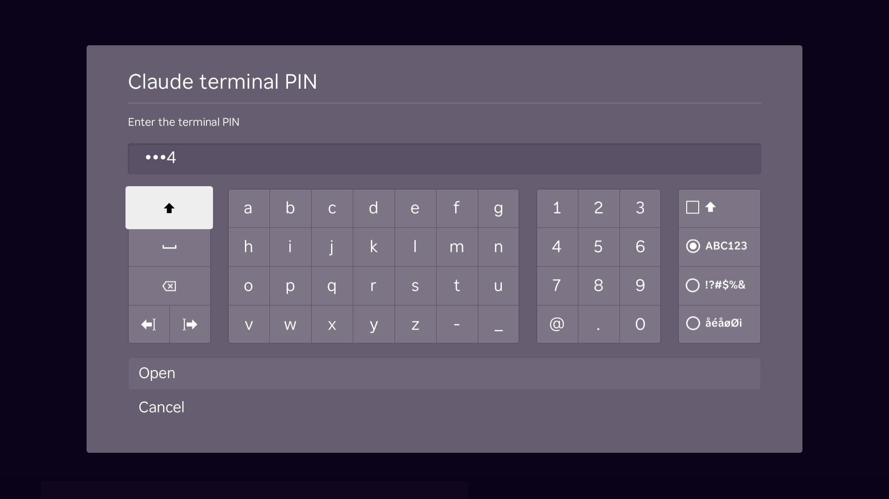


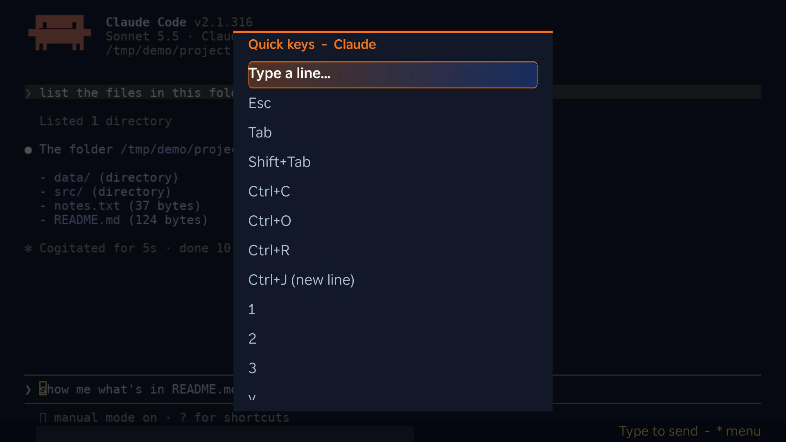

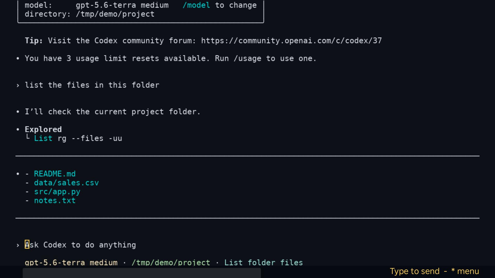

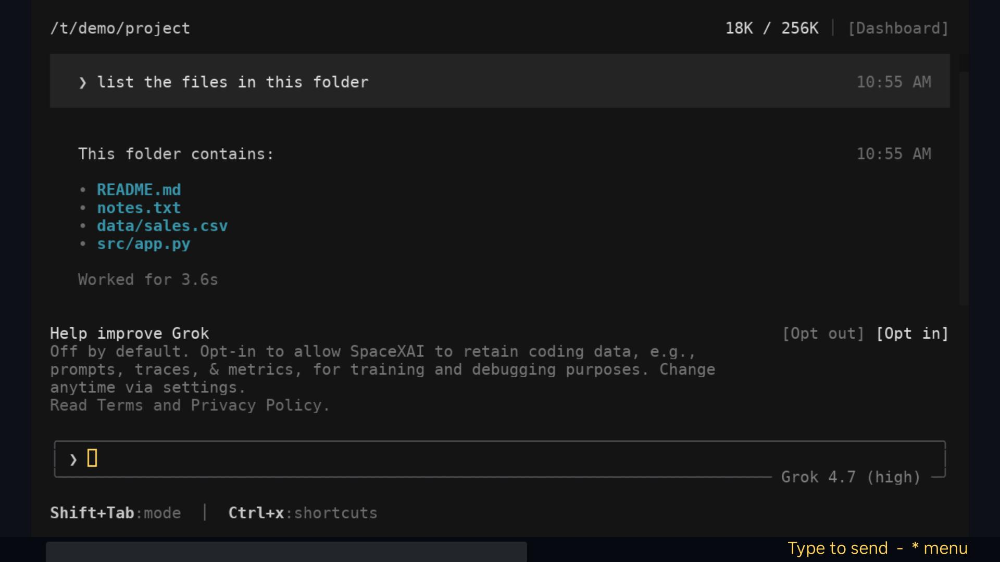

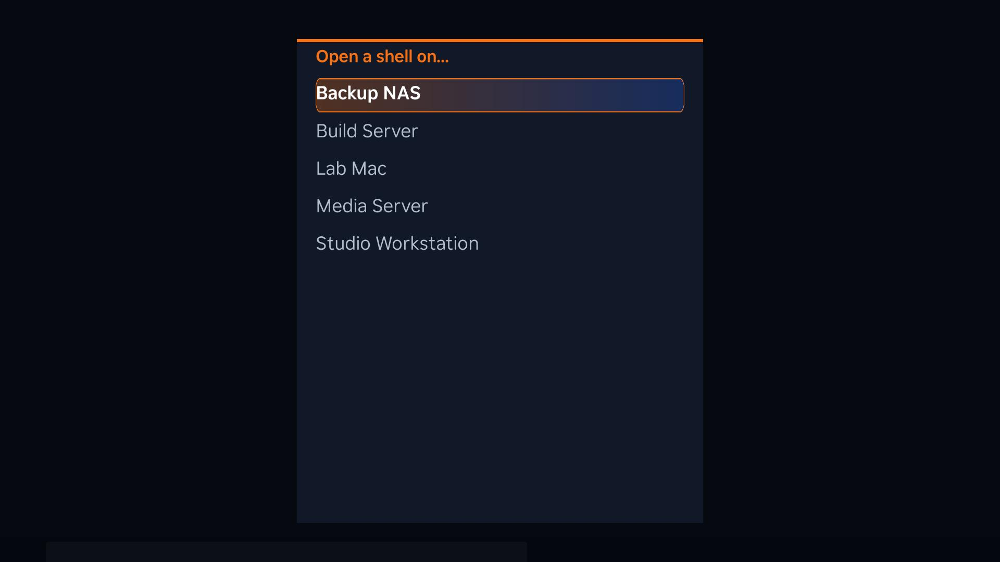

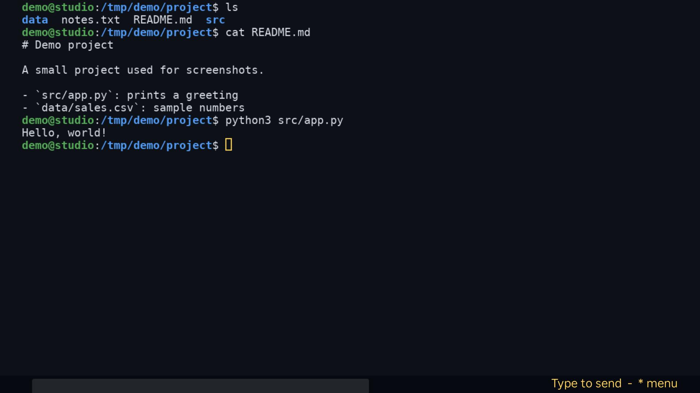

The first time, Claude asks whether you trust the folder. (Codex and Grok go straight to their prompt; Grok also asks once whether to share coding data. That one is your choice.) The highlighted choice is **"No, exit"**, which closes Claude, so press **Down** first and then OK to choose "Yes, I trust this folder". If Claude does end, press OK (Enter on Google TV) on the terminal screen to start it again.

Only open this on a network you trust: anyone who knows the PIN and can reach the bridge gets the same access you have at that computer.

### 7. JunctionBox settings, and using the launcher away from home

**JB Settings** is a tile on the TV's JunctionBox screen (Roku and Google TV). It asks for the terminal PIN once and then offers four pages, each a view of what the web Settings page already holds (the TV calls JunctionBox's own code, so the two can never disagree):

- **GPU Services.** Each service, whether it is running, and what shares its GPU. *Activate* stops the others that share the GPU and then starts that one (the web page's button); *Start* and *Stop* do just that service. The bottom bar warns when two services are running on one GPU.
- **Machine Credentials.** Every machine, and whether a sudo password is stored for it. You can set, replace or clear one. Passwords are write-only: they are saved encrypted, never shown, and never sent to the TV. Changing one works only from the home network (not through the away address below).
- **System Health.** Real checks, each with what it measured: the server, the agent daemon, database integrity, the encryption key, disk space, backups, the agent command-line tools, every machine answering, and every GPU service reachable. The overall answer is green only when every check passes; a check that cannot run counts as failing.
- **Away access.** Turns the away address on and off (below).

**Away access (Tailscale).** A Roku cannot run Tailscale, so a TV at a tailgate (another network) can't see this computer. Turning *Away access* on (on the TV, or in card 7 of the plugin page) connects Tailscale on this computer if needed and publishes **only the launcher bridge** at `https://<this computer>.<your tailnet>.ts.net:10000` with Tailscale Funnel. JunctionBox itself, and anything else Funnel already serves on this computer, is not touched (port 10000 is used because Funnel only offers 443, 8443 and 10000, and the others are taken). The TVs learn the address while at home and keep it; when the home address stops answering they try it, check the home address again every 20 seconds (Google TV: every minute), and go back as soon as it answers. Everything over the away address still needs the TV's key, and the PIN where the home network needs it; the few pages that answer without a key at home (box names, the channel list) need the key from away. Remote requests can look at and start or stop GPU services and see health, but cannot change passwords. This computer has to stay on, awake and online. Other addresses (for example your own Tailscale address) can be added by hand. The Google TV app needs version 1.1.2 for this; Rokus need app 1.1.34.

**Keeping Wireless debugging on (Google TV).** Android turns Wireless debugging off after a while and after every restart, which cuts the plugin off from the TV (pairing survives; the switch doesn't). When the app is installed, the plugin gives it a one-off right (`pm grant ... WRITE_SECURE_SETTINGS`, nothing else) to switch that one setting back on. The launcher checks when it opens and every two minutes, so after a restart it is on again as soon as the Home screen starts, and an off switch is put right within about two minutes. Turn it off by setting `gtv_keep_debugging` to 0 in the plugin's settings before installing, or revoke the right with `adb shell pm revoke com.junctionbox.launcher android.permission.WRITE_SECURE_SETTINGS`. App version 1.1.3.

### 8. Morning Briefing

A short narrated program, made fresh every morning on this computer from your own weather, calendar, the news, a scripture reading and the markets. It plays by itself the first time each TV is turned on that day. After that it is opened from the **Good morning, Tuesday, Nov 4** heading at the top of the home screen (on a Roku, press **Up** from the tiles and then **OK**; **Right** moves to the weather and **Left** back; on a Google TV it is the banner at the top). It has no tile of its own. It is part of the launcher, needs no graphics card, and nothing is made until you turn it on. It needs `ffmpeg` on this computer, and the narrator voice is a one-time download from the **Install the voice** button on card 14 (without it the briefing uses a plainer fallback voice, or silent captions). The starter background clips ship with the plugin. The setup page has these cards (8 to 15):

| Card | What it does |
|---|---|
| 8. Turn it on and set when | The master switch, the time it starts being made (about half an hour of work, mostly the voice, so set it well before you wake), how many times to try again if a run fails (0 to 6, with a growing wait between tries; a run that stops making progress is detected and restarted, and a computer that was off at the set time catches up when it starts), the length (3 to 20 minutes), how many days to keep, **Make today's now**, **Stop**, and **Read today's script**. It shows how far a run is, what was left out and why. |
| 9. What is in it | Weather and alerts, your calendar, the news, scripture, markets: each on or off, in your order, with a share of the time. A part with nothing to say that morning is skipped and its time goes to the others. A severe weather alert is moved to the front. |
| 10. The news | Topics to search for, subjects to leave out, and whether an AI agent writes short summaries. A topic can hold several search phrases separated by **\|** (for example `Mississippi election results \| Senate results`) and an optional story **limit**, which is shared across its phrases. **What matters most** is a short instruction (up to 600 characters) saying what to cover first, such as your own state's results ahead of everything else. Stories come only from the search results, with the outlets named at the end; when the local search is throttled the briefing falls back to Google News. Long lists are summarised in batches, so one failure only leaves that batch as published headlines. State abbreviations are read as full names ("Mayhew, MS" is spoken as Mississippi). |
| 11. Scripture | The reference is announced the way a person says it ("Proverbs chapter 4, verses 1 through 5"). Reads from the Bibles that ship with the launcher (public-domain texts), cut only at whole verses: a Psalm and a Proverb by the day of the month, a book read a little each day, one passage you choose, or daily readings from a table you supply (a wrong feast day read aloud is worse than none, so none is built in). |
| 12. Your calendar | Add each Google Calendar with its **secret address in iCal format**. The address is kept on this computer in an owner-only file and is never shown again; calendars appear by name. Private events are read as "Private event". **Test the calendars** reads each once. |
| 13. Markets | Index and commodity figures from a best-effort public feed (or a free Finnhub key you add), Treasury yields straight from the US Treasury. Every number is read with its date and whether it is a close. It never gives advice. |
| 14. Voice and pictures | The narrator (Kokoro, on the processor), its speed, picture themes, and the clip library. Short clips are played as slow seamless loops; with no clips, soft moving backgrounds are used. Clips made in Video Studio can be added. |
| 15. On the TVs | Whether TVs play it by themselves, which ones, and the hour after which they don't. |

How it plays by itself: a Roku starts it directly, without stopping at the menu, when it is turned on, if today's briefing is ready, that TV hasn't played it today, and it is before the cut-off hour (it must be within 15 minutes of the TV being turned on). A Google TV starts it the first time its home screen shows each day. **Back** skips it and the launcher is underneath. Each TV does this once a day.

**Opening it.** Press **Up** from the tiles to highlight the "Good morning" heading, then **OK** (**Right** moves on to the weather):

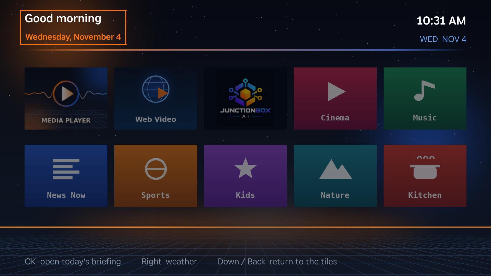

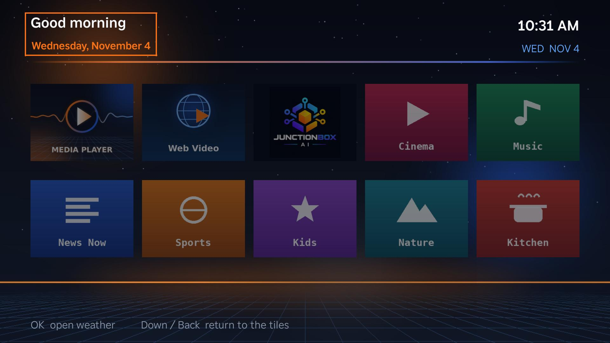

**The briefing page** shows the day's picture, its length and parts, with **Play** and a start point for each part:


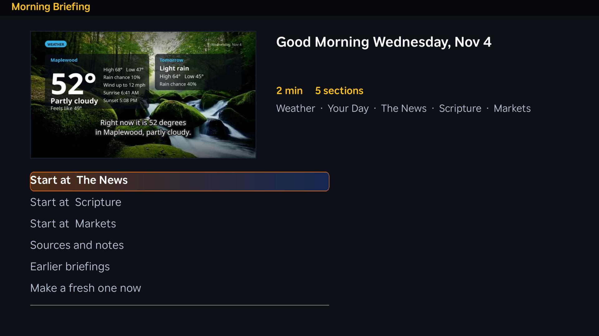

| | |
|---|---|
| 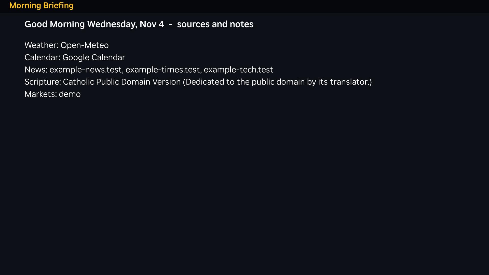 | 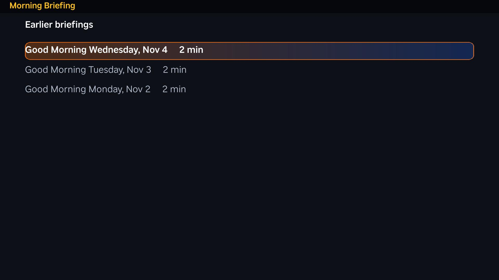 |

**What the video looks like** (frames from a made-up demo briefing; the TV's screenshot tool can't capture video, so these come from the video file itself): the title, then weather, your day, the news, scripture, markets and the sources.

| | |
|---|---|
| 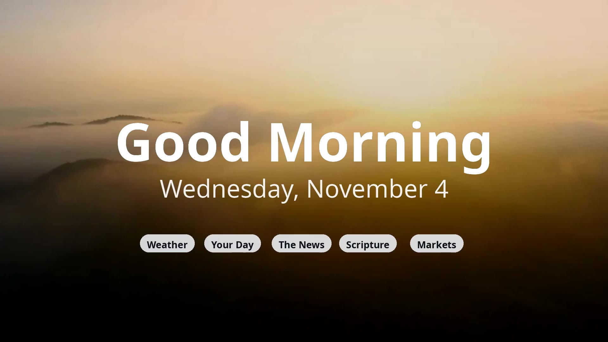 | 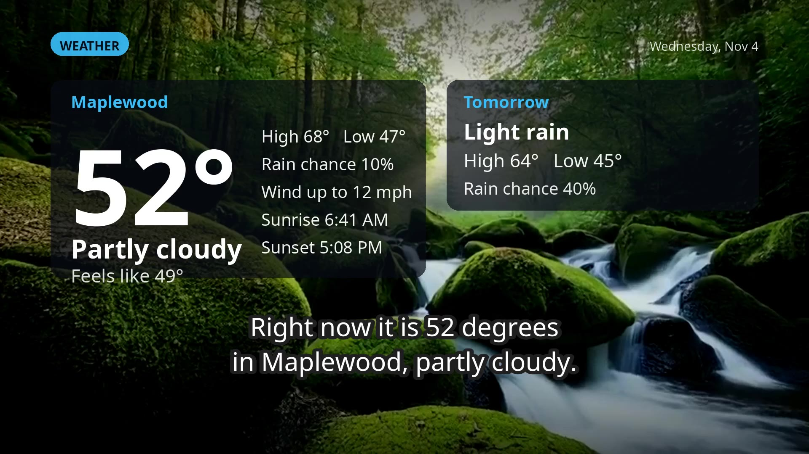 |
| 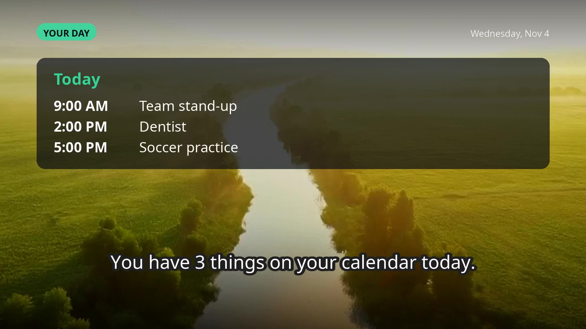 | 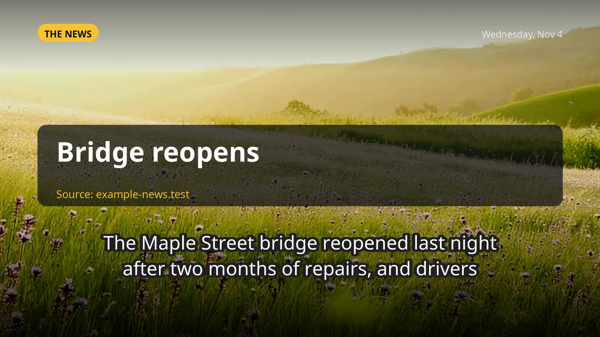 |
| 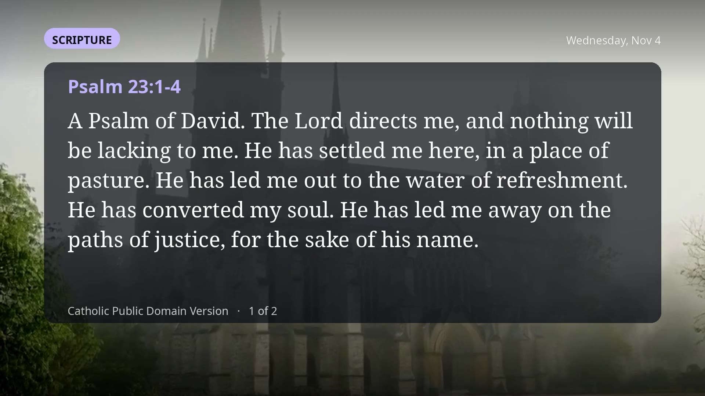 | 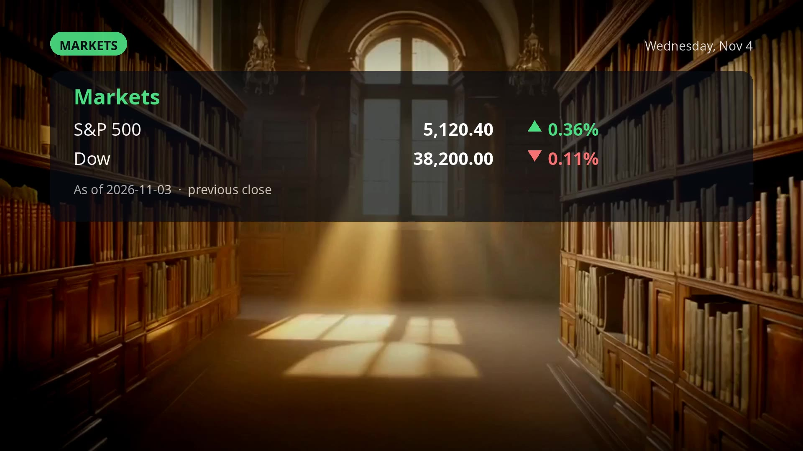 |

On the TV, the heading opens a page with the day's picture, its length and parts. **OK** plays, or start at any part. While it plays: **OK** pauses, **Left / Right** go back and forward 10 seconds, **Up / Down** jump to the next or previous part, **Back** skips. **Sources and notes** lists where everything came from and anything left out. **Earlier briefings** shows the last week. **Make a fresh one now** asks this computer to make it again. A very large news day can make the program longer than the length you set, since news is given most of the time.

**What has been tested on a real TV.** The Roku app (menu, playback, auto-play on first turn-on, the heading shortcut) has been run on Roku TVs. The Google TV page has been checked in a browser only; playing the briefing on an actual Google TV has not been tried yet. The voice has been tuned by pace and checked by ear on a Roku only.

### How the two kinds differ

- **Home screen.** On a Roku, the bridge watches the TV and sends it back to the launcher when you leave an app (auto-return). On a Google TV the launcher is the Home screen itself, so the Home button comes back to it.
- **Screens.** The Roku launcher is a native Roku app. The Google TV launcher is a small Android app that shows pages served by the bridge, so those screens update without reinstalling anything. Both have the same screens: apps, weather, Home Control, Ring Security, Video Studio, Photos, Books, Box Status and Media Player, and the Watch List. **Web Video** (the remote-controlled browser) is Roku-only, because Google TVs already have real browsers. The newer tiles (**Recipes**, **Agents**, **Screen Share**) are on both; on a Google TV they are pages in `launcher/bridge/gtv/` (`recipes.js`, `agents.js`, `share.js`, with shared menus, text box and PIN pad in `ui.js`), so they update with the bridge.
- **Building the Google TV app yourself.** The app's sources and a build script that needs only the Android command-line tools are in `launcher/android` (see For developers).


## Game schedules (card 9)

Pick a favourite team and its schedule stays up to date by itself.

- **Add:** choose a sport (or leave it on any), type the school, city or team, press **Find**, press **Add**. The leagues are NFL, college football, UFL, NBA, WNBA, men's and women's college basketball, MLB, college baseball and softball, NHL, college hockey, MLS, NWSL, Premier League, La Liga, Bundesliga, Serie A, Ligue 1, Liga MX, Champions League and women's college volleyball. Schedules come from ESPN's public service (no account). Up to 24 teams.
- **Tile:** each team gets a tile on the hub row of Roku and Google TV, just after Books, drawn by the bridge (logo, team colours, the sport, and "Saturday 3:15 PM vs Vanderbilt SEC Network", red **LIVE** with the score during a game). It opens the full schedule: every game with date, time and channel, results (W/L and score) for played ones, the next game selected.
- **Briefing and calendar:** every game goes into the Morning Briefing on game day ("Mississippi State at Auburn on ESPN"); a game whose time isn't set yet is an all-day entry. The card also shows a private calendar address to subscribe to on a phone or in Google Calendar (all games, with results).
- **Freshness:** the bridge re-reads each schedule every 3 hours, and every 10 minutes around game time (scores, delays, time changes).
- **By agent:** `POST /teams/add` on the bridge (bridge token) with `{"team": "Mississippi State", "sport": "football"}` adds a team; if the name could be several teams it answers with `choices` and adds nothing. `GET /teams/manage` lists the teams, `POST /teams/remove {"key"}` removes one.

## TV reminders (card 10)

Tell the TV what to remind you about. At each chosen time the TV **turns itself on**, fills the screen with the reminder, **says it aloud** (the narration voice) and asks again every few minutes until someone presses **Done**.

- **What:** a name, optional details, and optionally the event's own start time (used in the spoken text and in the briefing).
- **How often:** once, every day, certain days of the week, **a certain weekday of the month** (for example *the first Wednesday*, or the last Friday), a date each month (day 31 means the month's last day), or a date each year.
- **When:** any number of alerts, each "that day" or "N days before" at a time, with optional words ("Time to go to the"). The usual set is the day before in the evening, then that morning, mid-afternoon and early evening.
- **Which TVs:** tick some, or none for every TV. **Turn the TV on if it's off**, **Say it out loud** and **Keep asking** (every 5 to 30 minutes, up to 4 more times) are per reminder.
- **On the TV:** OK = Done; Down gives "Remind me in 15 minutes" and "In 1 hour"; Back hides it for now and it asks again. If the TV was showing another Roku app, Done returns to it.
- **How it reaches a TV:** a Roku is turned on with its power key (PowerOn) and started with the reminder; a Google or Fire TV is woken over adb through the plugin, and its launcher page asks the bridge every 15 seconds. A reminder missed because the computer was off still goes off if it is less than 3 hours late; nothing is replayed after that.
- **Briefing:** the day's reminders are calendar entries in the Morning Briefing.
- **Test now** on each reminder sends it to its TVs at once.
- **By agent:** `POST /reminders/add` on the bridge (bridge token) with the same fields as the page (`title`, `repeat`, `alerts`, optional `tvs`, `nag`, ...); `GET /reminders/manage` lists them.

## Picture frame (card 11)

When a TV's launcher has been idle for a while, the TV turns into **a framed painting that fills the screen**: a famous work in a frame of your choice, edge to edge, with no wall behind it and no label. **Any button on the remote** closes it and brings the launcher back.

**Where the paintings come from.** Two public-domain sources. (1) **Famous masterpieces**, a hand-picked set from Wikimedia Commons (on by default): *The Starry Night*, *Mona Lisa*, *Girl with a Pearl Earring*, *The Birth of Venus*, *The Scream*, *Wanderer above the Sea of Fog*, *The Night Watch*, *Sunflowers*, *Irises*, *Liberty Leading the People*, *The Hay Wain*, *Ophelia*, *Whistler's Mother*, *The Last Supper*, *View of Delft* and more, each kept only if it is public domain and big enough to fill a TV. (2) The Art Institute of Chicago's open collection by artist, using only works it marks as public domain (paintings where the artist has at least ten, otherwise prints too). Choosing an artist also brings that artist's famous works. JunctionBox downloads each painting once (about 1 MB) and keeps it, so the TV never waits on the museum. The default is **Famous masterpieces** plus **Claude Monet** (22 paintings). You can add others, including Van Gogh, Renoir, Cezanne, Degas, Seurat, Pissarro, Manet, Cassatt, Morisot, Sisley, Caillebotte, Gauguin, Toulouse-Lautrec, Sargent, Homer, Turner, Hokusai and Hiroshige. The bridge draws each picture (painting, mat and frame) into one 1920x1080 image, so the TV only has to show it.

**Settings (card 11 on the setup page).**
- **Show the picture frame when a TV is idle** (on by default) and **how long to wait** (1 to 60 minutes; the default is 3).
- **Frame:** Gilded (ornate gold), Walnut, Cherry, Natural oak, Weathered barnwood, Rustic shiplap (whitewashed boards), Antique bronze, Black and gold, Black gallery (with a wide white mat), White, Silver, or **No frame** (the painting fills the screen). The preview on the page shows your choice with a real painting.
- **Mat** (the border between the frame and the painting): **Chosen to suit the frame** (the default, a thin cream or white mat), **No mat**, or one of about 45 shades in color families: **Neutrals** (white, ivory, cream, linen, sand, tan, taupe), **Grays** (fog, dove gray, soft gray, slate, graphite, charcoal, black), **Blue-greens** (mist, seafoam, eucalyptus, lagoon, teal, spruce, deep teal), **Greens**, **Blues**, **Warm** tones, **Yellows** and **Purples**. To match any room, use **Match your room: pick any color**, which takes any color at all. The TV's own Mat color item goes round the named shades.
- **How it fills the screen:** **Stretch the painting to fill the frame** (the default: the frame sits at the very edge of the TV and the painting is stretched to fill all of it, so a painting that isn't TV-shaped is stretched a little), **Fill the whole screen** (no stretching; a wider mat fills whatever the painting doesn't, as with a square painting on a wide TV), or **Follow the painting's shape** (the frame fits the painting, with black beyond it).
- **How long each picture stays:** every 10 seconds, 30 seconds, a minute, 5 minutes, 15 minutes, an hour, **a new painting each day**, or **never: keep one picture** (pick which one, or leave it on today's pick).
- **Artists** to draw from.
- **Each TV** can be turned off, or given its own frame, mat, fit or timing, or **held on one painting of your choice** (the *Picture* button next to each TV opens a gallery of thumbnails; click a painting). Changes to one TV are not applied until you press **Save** (the TV shows *Not saved yet* until then); **Save and show on this TV now** also puts the frame on that TV's screen right away, if it is on and showing the launcher (it never interrupts another app). A TV that is already showing its frame picks up a saved change within about 30 seconds. **Undo changes** puts the controls back. The Nursery could keep a different look from the Brewery.

**When it starts.** Only when the launcher itself is idle: the home screen or the JunctionBox hub. It never starts over something you are using (a terminal, a video, a book, a reminder). A reminder that goes off still appears on top of the frame.

**Turning it off easily.** In JunctionBox: untick **Show the picture frame when a TV is idle** (all TVs), or untick **On** for one TV. On the TV itself: **Settings** (the tile on the home screen) has **Picture frame is ON for this TV - press OK to turn it OFF**, then **Frame**, **Mat color**, **Fit** and **Picture**, where each press of OK goes to the next choice for that TV only (Picture goes through the paintings one by one and the last press goes back to *Changes by itself*), and **Show the picture frame now** so you can see it.

**Good to know.**
- A Roku's own screensaver starts after its own wait time (**Settings, Theme, Screensaver** on the Roku). If that is shorter than the frame's wait, the Roku's screensaver takes over first. Set the frame's wait shorter than the Roku's.
- The frame uses the TV's screen the whole time it is up. It is meant for living spaces; leave it off where a TV runs for long periods unwatched if you worry about panel wear.
- Pictures are kept in `~/.roku-launcher/frame/` (a few tens of MB).

## Music (card 12)

The **Music** tile (on the JunctionBox screen, after Books) plays music on the TV, from four places, all browsed as simple lists:

- **My music**: folders on the computer that runs JunctionBox (the default is `~/Music`; add others on the setup page). Songs are grouped by artist and album from their tags, with cover art from the file or a `cover.jpg` in the folder. MP3, M4A/AAC, FLAC and WAV play as they are; Ogg, Opus and WMA are converted on the fly. The library is rescanned every ten minutes and only changed files are looked at again.
- **Music server**: anything that speaks the Subsonic API (Navidrome, Gonic, Airsonic, Jellyfin with its Subsonic add-on). Enter its address, user and password on the setup page; the bridge talks to it, so the TV never sees the password.
- **Internet radio**: SomaFM's channels, the most popular stations, 16 genres, and a search, from the public Radio Browser directory. Only streams a TV can play are shown. Press `*` on a station to save it to **My stations**.
- **Podcasts**: search Apple's free podcast directory, subscribe, and play episodes. Each episode remembers where you stopped and offers to resume.

**On the TV.** OK opens or plays; `*` gives options (save a station, play all, play all shuffled, stop); Back goes up a level, and at the top it leaves the screen **while the music keeps playing** (open Music again to see and control it). The Play key pauses, Fast-forward is next, and Rewind is previous (or the start of the song). The bar at the bottom shows what is playing, the cover, the time and the place in the queue.

**On the setup page (card 12):** your music folders with *Scan now* and a song count, and the music server's address, user and password with *Test the connection*.

**Good to know.** The radio and podcast lists come from public directories (Radio Browser, SomaFM, Apple's podcast search): your computer contacts them, not JunctionBox AI. Music is free; it is not one of the paid features. Spotify, Apple Music and similar services are not supported (they don't allow other apps to stream their catalogs); use their own apps from the home screen. Songs and pictures are served to the TV only through signed addresses, and only files inside the folders you chose.

## Picking up an earlier Claude, Codex or Grok conversation from a TV

In the Claude, Codex and Grok terminals, open the quick-key menu (`*` on Roku, Menu or `*` on Google TV) and choose **Resume an earlier conversation...**. The list shows the 30 most recent conversations of that tool on this computer (its own title, the folder it was in, how long ago). Pick one, confirm, and the TV terminal restarts on it with `claude --resume`, `codex resume` or `grok --resume`, in the folder the conversation was started in (the tools look conversations up by folder). It replaces what the TV terminal is running now, so a confirmation says so.

- A Claude conversation that is still open in another terminal on the computer is marked "(open)". Resuming it makes a copy (`--fork-session`), so two programs never write into the same conversation. Close the other one first if you want to continue the original.
- The list is read from the tools' own history folders (`~/.claude/projects`, `~/.codex/sessions`, `~/.grok/sessions`); nothing is copied or stored. The bridge only accepts an id that is in that list.
- **Restart** still starts a fresh conversation.
- Typing from the iOS Roku keyboard now holds up to 4000 characters (the Roku's text box used to stop at 15).

## Your own books (card 8)

Add ebooks of your own and they appear under **My books** in Books on every TV, with a saved place, dark mode, chapters and read-aloud (comics aside, everything the Bibles and Book Studio books can do).

- **Ways in:** choose or drop files on the plugin page; drop files in the inbox folder (`~/.roku-launcher/mybooks/inbox`, checked every 30 seconds, and **Check the folder now**); or **Find a free book**, which searches Project Gutenberg and downloads the EPUB (only from gutenberg.org).
- **Formats:** EPUB, PDF, Word (docx), text, web pages (html), RTF, ODT, FB2, and MOBI/AZW/AZW3 once **Add MOBI support** has been pressed (installs the `mobi` reader into the bridge's environment). Up to 400 MB each.
- **How:** the plugin makes one PDF per book (`~/.roku-launcher/mybooks/<id>.pdf` plus `<id>.json` with title, author and chapter list): pandoc turns the book into a web page and headless Chrome prints it on a 6 x 9 inch page. PDFs are kept as they are. The same book added twice isn't duplicated. A cover picture in an EPUB becomes page 1. Needs pandoc, Chrome or Chromium and poppler on the computer; without them PDFs can still be added.
- **DRM:** books from Kindle, Kobo, Apple Books and Google Play are locked and can't be opened; the card says so. Password-locked PDFs are refused too.
- **Read aloud** works when the book has real text (the card marks picture-only PDFs). Running heads and page numbers are dropped, and the screen follows the voice exactly because the text layer matches the page.
- Shared by the whole household; **Remove** deletes the book from the computer.

## Reading books aloud

Books can be read to you. It is off unless you choose it from a book's menu, and nothing changes for books you read by eye.

- **What is read.** Bibles are read from the text in their PDF: page headers and page numbers are skipped, verse numbers are not spoken, and each chapter is announced ("Genesis, chapter two."). A page can start in the middle of a sentence, so the reading is cut at sentence ends and the voice never stops half way through one at a page turn. **Book Studio** books are read from their chapter text in the database (their PDF pages are pictures), a few paragraphs at a time; figure captions and picture lines are skipped, and the page on screen follows along at an estimated place in the chapter. **Comic Studio** books are not read: their words are drawn into the pictures.
- **How it plays.** The bridge makes the speech on this computer with the same local Kokoro voice the Morning Briefing uses, turns it into mp3 and serves it to the TV. The section being read and the next two are made ahead of time, one at a time, so after a short wait at the start the reading goes on without gaps. The audio is cached by a hash of the text, voice and speed (so a repeat costs nothing) in `bookcache/audio` inside the launcher's data folder, and files untouched for 14 days are removed when the bridge starts. The first words of a Bible take roughly 20 to 40 seconds to be ready the first time.
- **Controls.** Roku: **Options (`*`)** opens the menu (Read aloud, Reading speed, Voice); while reading, **OK** or **Play** pauses and resumes, **Left/Right** move a page (the reading carries on from there), **Down/Up** scroll, **Back** stops and closes. Google TV: **OK** (or Menu) opens the options menu; **Play/Pause** pauses and resumes while reading and still switches the dark theme otherwise.
- **Settings.** Voice and speed are kept for the whole household in `narration.json` (default Heart, speed 1.0; speeds 0.85, 1.0, 1.15 and 1.3 from the menu). Changing them affects the next sections made; sections already made keep their voice.
- **Needs.** The Kokoro voice (installed for the Morning Briefing) and `ffmpeg`, `pdftotext`. If no voice is installed the menu says so.
- **Bridge routes.** `GET /books/narr?key=...&page=N` (or `seg=N`) returns the section to play and whether its audio is ready (ask again in two seconds if not); `GET /books/narr/audio/<signed prefix>/<key>/<hash>.mp3` serves it with Range; `POST /books/narr/settings` saves the voice and speed.

## Android tablet launcher

The plugin also contains a launcher for an **Android tablet** (Android 8 or newer). It is a small app, `tablet.apk` (package `com.junctionbox.tablet`), that shows the bridge's touch pages full screen and can be the tablet's Home screen. The pages come from your computer, so new features appear without reinstalling the app, and the same bridge and key are used as for the TVs.

- **Home:** your apps as icons (with favorites you choose) and the JunctionBox plugins you pin. A battery and network indicator is shown, and the app can float as a small picture-in-picture window.
- **Screens:** **Agents** (chat with your JunctionBox agents), **Home Control**, **Recipes**, **Reminders**, **Cameras** (Ring), **Terminal** and **Screen Share**. Agents, Terminal and Screen Share use the same PIN as on the TVs (card 6); one PIN unlocks all three.
- **Away from home:** it tries the other addresses JunctionBox publishes (Tailscale Funnel, card 7) when your home address can't be reached.
- **Setting it up (by hand for now; the plugin page has no install button for tablets):**
  1. On the tablet turn on *Developer options* and *Wireless debugging* (or connect USB debugging), and connect from your computer with `adb`.
  2. Install the app, which is in the plugin's folder (`~/.junctionbox/plugins/smart-tv-launcher/launcher/android-tablet/tablet.apk`): `adb install tablet.apk`.
  3. Give it the bridge address and key once: `adb shell am start -n com.junctionbox.tablet/.MainActivity --es bridge http://YOUR-COMPUTER:PORT --es token KEY`. The address is your computer's address on the home network and the bridge's port (8791 unless you changed it, in which case it is in the file named `port` in the bridge's data folder), and the key is the file named `token` in that same folder (`~/.roku-launcher` on Linux and macOS).
  4. Press Home on the tablet and choose JunctionBox as the Home app if you want it to be the Home screen.
- **Building the app yourself:** `launcher/android-tablet/build_apk.sh` builds it with the Android SDK command-line tools. The signing key is kept outside the plugin (`~/.junctionbox/tablet-launcher-android.keystore`); keep it, because a tablet only accepts an update signed with the same key.
- **Files:** the app is in `launcher/android-tablet/` (`src/.../MainActivity.java`), the touch pages are in `launcher/bridge/tablet/` (`index.html`, `core.js`, `home.js`, `agents.js`, `hc.js`, `recipes.js`, `reminders.js`, `cameras.js`, `terminal.js`, `share.js`, `unlock.js`), and the bridge serves them at `/tablet/` and keeps each tablet's favorites and pinned plugins (`/tablet/favorites`, `/tablet/pinned_plugins`).

## The Grill tile

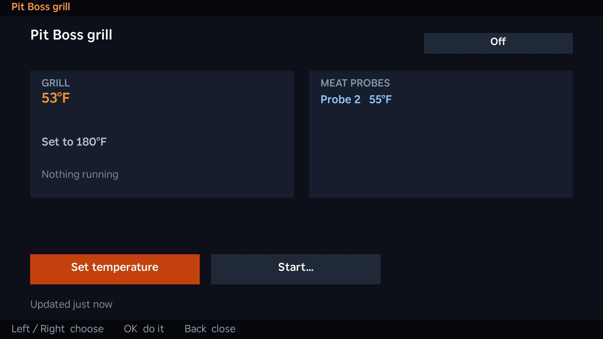

## Games (card 13)

The arcade lives behind a **Games** tile on the JunctionBox screen, so the games do not crowd the plugin rows: OK opens a one-row menu of the games, Back returns to the JunctionBox screen, and leaving a game returns to that row. Four original games, free for everyone, each with its own menu (play, High Scores, Settings, How to Play) and a household top ten kept by the bridge:

| | |
|---|---|
| 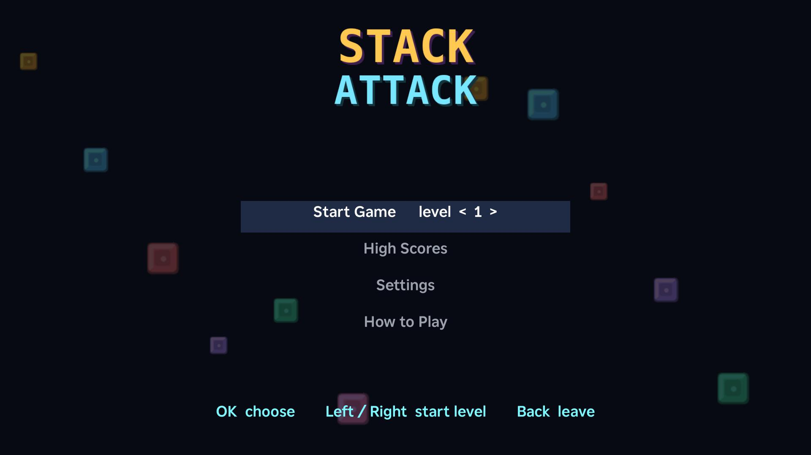 | 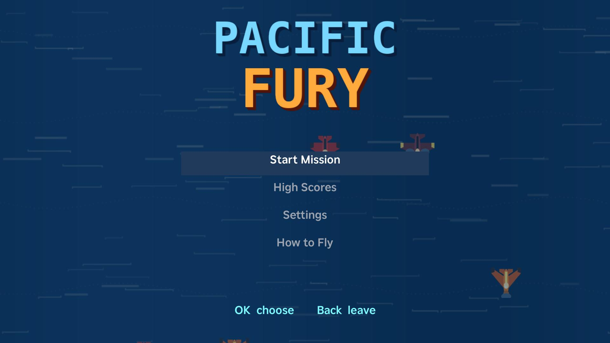 |
| 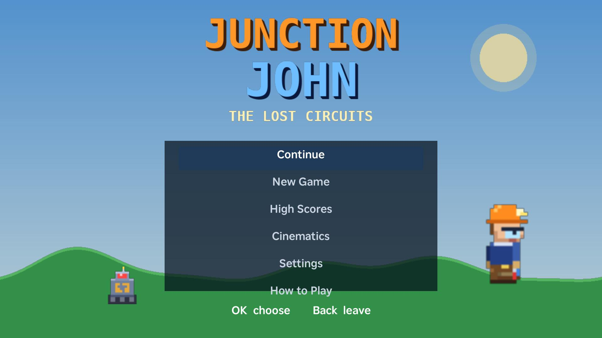 | 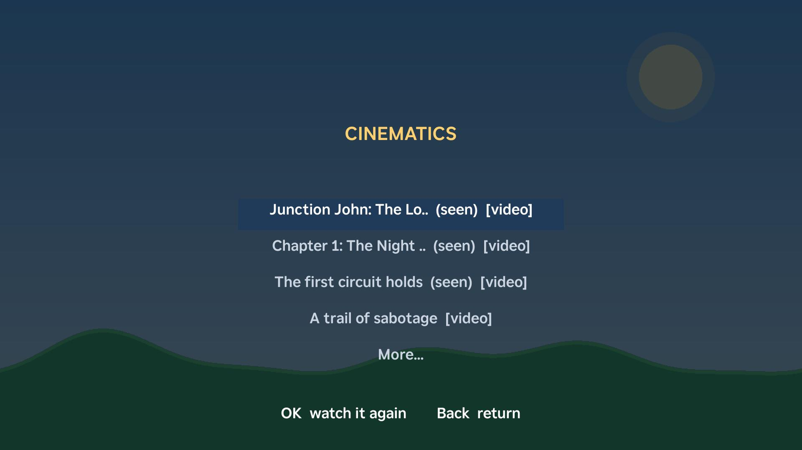 |

## Tap Takeover, the game (card 13)

A maze game on the Roku, on the JunctionBox screen next to Music, free for everyone. You are a pint glass sliding along a bar top collecting bubbles while four bottle caps chase you. The big glasses in the corners (a fresh pour) let you knock the caps for a few seconds; hops, pretzels and barrels are bonus points. It is entirely original: the pictures, sounds and mazes are drawn by `launcher/tools/make_game_assets.py` (the same seeds always give the same four mazes, each checked to have no dead ends and no cut-off corners).

- **Controls:** arrows move, OK or Play pauses, Back pauses and then quits. Three glasses, an extra glass at 10,000 points, and the caps speed up each level.
- **The caps:** each chases differently (straight at you, ahead of you, a flank from the first cap, and one that shies away when it gets close). They alternate between scattering to their corners and chasing, and the house door opens one at a time.
- **Scores:** the top ten for the whole house are kept on the computer (`~/.roku-launcher/game-scores.json`) so every TV shares one list. A new high score asks for three letters. Card 13 on the plugin page shows the list (with which TV set it) and can clear it.
- **Where it runs:** Roku only for now. Sounds are played from the app's main thread (a Roku only allows that), pictures and sounds ship inside the app (`app/images/game`, `app/sounds`).

## Stack Attack, the falling-block game (card 13)

A second arcade game on the Roku, next to Tap Takeover on the JunctionBox screen, free for everyone. Seven four-square shapes fall into a 10 x 20 field; fill whole rows to clear them, score, and level up while the pieces fall faster. Everything in it is original: the chip pictures, the sounds, two looping music tracks and the layout are drawn and synthesised by `launcher/tools/make_stack_assets.py`.

- **Controls:** Left/Right move (hold to glide), Down soft drop, Up turn clockwise, Rewind turn back, **OK drops the piece all the way**, `*` or Fast-forward holds a piece (once per piece), Play pauses, Back opens the menu. A faint outline in the piece's colour shows where it will land; the next three pieces and the held piece are shown. You can press a move before a new piece appears and it is applied as the piece arrives.
- **Screens:** title (start level 1 to 10, high scores, settings, how to play, with an animated background), game, pause (Resume, Restart, Controls, Quit with a confirmation), game over (score, level, rows, and whether it is a new high score), initials entry, the household top ten, and settings (music on or off, sound effects off, low or high, particle effects, the landing outline). Settings are kept on the TV between visits.
- **The rules (fixed so scores stay comparable between releases):** clearing 1, 2, 3 or 4 rows scores 100, 300, 500 or 800 times the level; soft drop is 1 point a row and a hard drop 2; each further consecutive clearing piece adds 50 x (chain - 1) x level; four rows straight after four rows scores 1.5x; emptying the field adds 2000 x level. Every 10 rows is a level (up to 30); a row falls every 800 ms at level 1 and 14% quicker each level down to 50 ms. A resting piece locks after 500 ms, and moving or turning it restarts that up to 15 times. Pieces come from a shuffled bag of the seven shapes. A turn that doesn't fit is nudged by the first of these that works: in place, 1 left, 1 right, 2 left, 2 right, 1 up, 1 up and 1 left, 1 up and 1 right. The full text is at the top of `launcher/tools/stack_rules.py`.
- **Scores:** the household top ten (initials, score, level, rows cleared, the TV's name and the time) is kept on the computer in `~/.roku-launcher/stack-scores.json`, separate from Tap Takeover's. Each game sends a session id, so sending the same game twice counts once; the bridge checks every field (three letters, ranges) before keeping it. The plugin page (card 13) shows both lists and clears either. A separate list, `stack-arcade`, is reserved for a future special-blocks mode so competition on the standard rules stays fair.
- **Only the final score leaves the TV.** The whole game runs on the Roku; the bridge is asked for the top ten when the game opens and told the score when a game ends, never during play.
- **Checking it:** the rules are written twice, in Python (`stack_rules.py`, with the tests in `backend/tests/test_stack_rules.py`) and in BrightScript (`StackRules.brs`). `tools/stack_golden.py` plays scripted games through the Python version and writes the results to `StackVectors.brs`; starting the Roku app with `contentId=stacktest` (for example `POST http://<tv>:8060/launch/dev?contentId=stacktest`) replays them on the TV and prints PASS or FAIL per game on the debug console (port 8085).

## Pacific Fury, the air-combat game (card 13)

A vertical-scrolling air-combat game on the Roku, third in the arcade next to Tap Takeover and Stack Attack, free for everyone. You fly a fighter over the ocean through a six-mission campaign, shooting down enemy aircraft and sinking the warship that guards each one. Everything is original: the aircraft, ships, islands, clouds, explosions, sounds and two music loops are drawn and synthesised by `launcher/tools/make_fury_assets.py` (the aircraft markings are invented ones).

- **Controls:** the arrow keys fly the aircraft in all eight directions, and **it fires by itself**. OK drops a bomb (destroys enemy aircraft on screen, clears every enemy shot and protects you for a moment), `*` or Fast-forward changes weapon, Play pauses, Back opens the menu (Resume, Restart, Controls, Quit with a confirmation).
- **The campaign** runs straight through all six missions in one sitting, carrying score, armor, lives, weapons and bombs from one into the next; beating a mission's boss shows a brief "MISSION N COMPLETE" banner and flies straight into the next one's own waves and look. Enemy types: scout fighters fly straight down and fire now and then; interceptors chase you and fire an aimed shot; dive bombers come in from the sides, drop explosives and fly off; from Mission 2 on, **aces** (tougher, faster interceptors) join in; from Mission 4 on, **submarines** surface in place, fire twice, then dive again. Some enemies carry crates (armor, a 10-second shield, a weapon, a wingman, a bomb). Difficulty rises with each mission (denser waves, tougher enemies, faster-reloading guns).
  - **Mission 1, Open Ocean** — the battleship *Iron Tide*: four gun turrets (aimed shots, three-way fans, a ring of shots), then its bridge, unhurtable until every turret is down.
  - **Mission 2, Night Raid** — a darker, tinted sky and the carrier *Kuro Tsuru*, whose flight deck launches fighters from the moment it arrives, not only once exposed.
  - **Mission 3, Storm Front** — a rain overlay and occasional lightning flashes (with thunder), and the heavy cruiser *Gray Fathom*, tougher and faster-reloading than the *Iron Tide* in the same four-turret-plus-bridge layout.
  - **Mission 4, Silent Depths** — the submarine tender *Deep Warden*, whose bridge periodically retracts underwater and can't be hurt while submerged, even with every turret down.
  - **Mission 5, Coastal Assault** — a fixed, non-swaying coastal fortress, *Ironshore Redoubt*: the heaviest regular defenses in the campaign, reinforced by aces instead of interceptors.
  - **Mission 6, Home Fleet** — the finale: a gauntlet mixing every enemy type, ending on the dreadnought *Shogun*, the toughest hull, whose bridge is the only one that fires a full ring of shots. Beating it ends the campaign ("CAMPAIGN COMPLETE").
  - Every boss shares one state machine (`furyBossSpec`, `furyBoss`, `furyPartFire` in `FuryEngine.brs`): four gun parts plus a bridge/core, each picking one of a few shared firing patterns, so new bosses are new stats and a new hull silhouette rather than new fight logic — the same reuse-the-proven-state-machine approach used for Junction John's World 2 bosses.
- **Weapons:** twin guns, a spread, and a rapid cannon (shells go through the first thing they hit). The first two weapon crates unlock the spread and the cannon; later ones make the weapon in your hands stronger (level 1 to 3). Losing an aircraft costs a weapon level and your wingmen.
- **Fair play:** only the middle of your aircraft can be hit; you have 100 armor and three aircraft (an extra one at every 25,000 points, up to five).
- **Screens and settings:** title, mission card, flying, pause, mission failed or campaign complete (score, enemies downed, accuracy), initials entry and the household top ten. Settings: music, sound effects (off, low, high), smoke and screen shake. They are kept on the TV.
- **The loop is deterministic.** The rules (`FuryEngine.brs`) move in fixed 25 ms steps on whole-number positions with a seeded random generator, and the screen runs as many whole steps as the real time that has passed (at most 8 a frame), so the game plays the same at any frame rate and never speeds up on a faster Roku. Only the picture is drawn once per frame, from pooled sprites that are moved and reused.
- **Scores:** the household top ten (initials, score, the mission reached, enemies downed, the TV's name, the time) is kept in `~/.roku-launcher/fury-scores.json`, separate from the other games. Every game sends a session id so a repeat counts once. Card 13 on the plugin page shows and clears it. Only the final score leaves the TV.
- **Checking it:** start the Roku app with `contentId=furytest` (for example `POST http://<tv>:8060/launch/dev?contentId=furytest`) and the debug console (port 8085) prints PASS or FAIL for each of 40 checks: the same game at every frame rate, shooting, every power-up, the bomb, damage and losing aircraft, Mission 1's battleship turrets and bridge, the mission-to-mission carry-over, the carrier's always-on launches, the submarine tender's submerge, the ace and submarine enemy types, every boss's spec, and Missions 1 and 6 each flown to the end by an autopilot, with a timing line (a full six-mission autopilot flight was tried and dropped — it ran past the Roku's own script execution-timeout watchdog). `contentId=furyboss` flies straight to Mission 1's battleship (unhittable, with the autopilot) for practice.

## Junction John: The Lost Circuits, the platform game (card 13)

A side-scrolling platform adventure on the Roku that fills the whole 1280 x 720 screen, fourth in the arcade, free for everyone. John is a human electrician (orange hard hat with a headlamp, safety glasses, navy work shirt, gloves, a tool belt with a screwdriver, work pants and heavy boots) who has to restore the power. It is original 16-bit-style pixel art, drawn and synthesised by `launcher/tools/make_jack_assets.py`, and the main theme is an original tune written note by note in the same file (an 8-bit-style romp in D major at 152 beats a minute: a crisp pulse-wave lead, hopping triangle bass, off-beat chord pops and a light kick, snare and hat, with the last part lifting a whole step; about 50 seconds, looping; World 2 reuses this theme and the Titan's boss theme rather than new music). **World 1 and World 2 are built; Worlds 3 to 6, the cable launcher, and achievements are not built yet.**

- **Controls:** Left and Right run (keep going and John speeds up), **OK jumps forward, the way John faces** (hold for a high jump, tap for a hop; in the air tap Left or Right to steer and Down to stop drifting; Settings can switch this to straight-up jumps), Up climbs a ladder or pole (at the top John stays on it until Left or Right steps him off onto the platform; a very short tap counts as a nudge), mends a circuit (hold it at a repair point) and throws a switch, Down crouches or climbs down (Down with OK drops through a wooden ledge), `*` changes tool, Play pauses and Back opens the menu (Resume, Restart Level, Controls, Quit with a confirmation).
- **One button at a time:** the Roku remote can't send an arrow and OK together, so a jump needs no arrow held. With no arrow down John leaves the ground at 3.6 pixels a step in the direction he faces (more if he was already running faster), keeps that speed in the air, and can be steered with a tap. A jump from a standstill clears about a 5-tile gap when OK is held; an ordinary tap of OK is a full jump (Settings can make a tap a short hop instead, with a hold for the full jump), and **tapping Down and then OK** jumps straight up.
- **Feel:** a jump pressed up to 120 ms before landing still happens, John can still jump for 120 ms after running off an edge, and the jump is variable in height. He walks at 3.0 pixels a step and runs at 4.6 after half a second of running; a held jump rises 3.6 tiles and clears a 4-tile gap walking or 6 running.
- **Tools** (they work by themselves, so no button combinations are needed): the **screwdriver** swings at gear-bots when they come close, the **voltage tester** reveals secret switches (a blue tint shows it is on), the **circuit pulse** (five energy sparks make one) stuns every robot nearby. The wire strippers mend a circuit when John holds Up at a repair point. **Insulated boots** protect him from zappers and let him walk on live wires for 30 seconds. Power packs and toolboxes restore health.
- **The level:** coins, energy sparks, toolboxes, three golden fuses (one in a secret room), a broken circuit to repair so a bridge appears, two sliding platforms over pits of live wires, a pole to climb, three zappers, gear-bots that patrol and spark-bugs that fly, two checkpoint poles that light up and a power-station switch at the end that restores the power. Jump on robots to defeat them. There are six hearts and three lives, an extra life every 100 coins and every 20,000 points.
- **Things to collect (and break):** the old coins are now rotating spools of copper wire (10 points, still 100 for a life; the saved/score field is still called coins). Screws (25), light bulbs (75) and batteries (150) are mixed in among them. Cracked blocks (`X` in the grid, added over flat open ground by `add_extras` in `jack_levels.py`) hang at head height: jumping into one from underneath breaks it and pays out a screw, bulb or battery. Up now jumps straight up (it climbs at a ladders and keeps its job beside a circuit or junction box). Junction boxes crackle loudly as they open and John steps in, and a victory tune plays while the level's points are counted up row by row (skippable with OK).
- **Tools and the Mega Breaker:** the `<<` button scrolls through the tools John owns: screwdriver, voltage tester, the **circuit pulse** (once he has found one he keeps it for good: unlimited uses with a 3-second recharge) and the **energy-drink wings** (a can found on the ground in 1-1 and 2-1: press OK in the air to flap: each flap lifts him and drives him forward the way he faces for about a second, so flapping keeps him moving forward; hold OK to flap again and again, and press again if he starts to fall. About five seconds of flapping, refilled on the ground and also in the air when he starts to fall from a really great height (more than seven tiles above where he last stood)). Owned tools carry to every level and are saved with the game. The **Mega Breaker** is in a hidden brick in each ordinary stage (invisible, faintly shown by the voltage tester): bump it from below and it shows itself, breaks, leaves a solid block and the Breaker pops up on top. Collecting it swells John to three times his size with three electrical pulses and the line TIME TO THROW THE BIG BREAKER!. There is no timer: Giant John flattens robots by touching them, smashes cracked blocks by walking into them, and makes a shockwave when he lands hard. Any hit from a boss, a bolt or a robot's attack (or dying or falling out of the level) takes the Breaker instead of a heart and shrinks him; live wires and zappers still cost a heart. His body box is 26 by 64 pixels so he still fits through the two-tile secret-room openings. He keeps it between levels (carried and saved). The picture is the normal sprite scaled up (no separate hard-hat and belt animation).
- **Cheat:** on the title screen or the pause menu press Up Up Down Down Left Left Right Right to switch unlimited wings on or off (it grants the wings and is remembered on that TV; the hint line at the bottom says which).
- **Conduits, the Fuse Vault and the Grid Map:** copper **conduits** (two tiles wide) stand about the levels. A plain one is scenery John can stand on (Down does nothing). A few lead somewhere: a hidden one on a high ledge in 1-2, 2-2 and 3-2 takes you down (stand on top, press Down) into **The Fuse Vault**, one room full of extras (a spool run, bulbs, a battery, a power pack, a toolbox) with a conduit back out. Entering again puts the level back exactly as it was (collected items, repairs, broken blocks) and keeps whatever John picked up in the vault. The vault's ceiling is a row of cracked blocks: climb the steps, bump a block out with the helmet, jump up through the hole and run along the top to **the Grid Map**, where conduits labelled TO WORLD 2 and TO WORLD 3 warp straight into those worlds.
- **Worlds and their robots:** each world has its own layouts, scenery and robots, and no two levels share a layout (a test checks). World 1: gear-bots and spark-bugs. World 2 (the power plant, stages 6-10): spring-legged **hoppers** that hop after John, floor **turrets** that fire along the ground, spark-bugs and zappers. World 3 (the storm grid, stages 11-15: Pylon Ridge, Lightning Fields, Magnet Mine, the Storm Colossus's arena and the Thundercloud bonus level): **spark plugs** that pop up out of the floor (can't be stomped), **ball lightning** that drifts after John, and the turrets. Stages 7, 8 and 11-13 and both bonus levels are built from plans by `gen_level`/`make_bonus_gen` in `jack_levels.py` (a seed and a list of segments each) and pass the same reachability checks.
- **Mini-bosses and bosses (all different):** World 1: Static Beetle (rams to a post), Sparkhawk (bump its platform), Storm Drone (dives), Transformer Titan. World 2: **Piston Press** (leaps onto where John was; the landing sends shockwaves), **Geyser Valve** (marks the floor then steam geysers shoot up; out of steam afterwards), **Steam Wraith** (solid and low, then fades out and reappears; jump on it while solid), and the **Generator Golem** (the Titan's fight). World 3: **Digger Mole** (tunnels under John, dirt shakes, bursts up), **Tesla Coil** (calls lightning strikes onto marked spots; overload its three breakers, hold Up at each, instead of stomping), **Magnetron** (pulls John towards it, then overloads and crashes), and the **Storm Colossus** (stomps, storm strikes, then channels the storm with its arms up: only then does bumping one of five lightning rod blocks from underneath call the storm down on it; a rod bumped at any other time is wasted).
- **The story (Junction John: The Lost Circuits):** the game is a story adventure: Baron Von Voltage has kidnapped Junction Jane and is draining the six Great Circuits with the Voltage Vortex. The story bible is `docs/JUNCTION_JOHN_STORY_BIBLE.md`; the machine-readable catalogue of every scene (trigger, dialogue, story card) is `plugins/source/smart-tv-launcher/story/cinematics.json`, and `tools/make_jack_assets.py` writes it into `JackStory.brs`. Scenes fire by stage id (`new_game`, `enter_stage`, `stage_complete`), once per TV (`story-watched.json` in the bridge's data folder), and can be replayed from **Cinematics** on the title screen. Each scene shows its **story card** (the dialogue as text) unless a cinematic has been **published** for it, in which case the video is streamed from the bridge through the existing signed `/vs/video/` path (not stored on the Roku); Back skips, OK pauses; a video that doesn't start in 15 seconds, or any error, drops to the story card, and with JunctionBox off the cards still work, so nothing in the game depends on video generation.
- **Cinematic production:** cinematics are made on Iris and registered in Movie Maker (Video Studio) as ordinary projects and exports. The **Junction John Cinematic Director** agent role (prompt in `story/director_prompt.md`) plans and tracks them. The pipeline is `~/jjprod` on this computer (not part of the plugin): reference sheets and keyframes with Qwen-Image-Edit conditioned on the approved character masters, Wan2.2 14B image-to-video (Lightning, 832 x 464, about three seconds per animated shot) or slow camera moves on stills, Kokoro voices per character (`story/characters.json`), the game's own music, subtitles burned in, FFmpeg assembly, then a Movie Maker export. The plugin page's **Junction John cinematics** card (14) lists every scene with its status, previews the mapped export and has Approve, Publish, Unpublish and Regenerate: nothing plays in the game until a person has approved and then published it. The mapping lives in the plugin's `jj_cinematics` table.
- **Worlds 4-6:** World 4, the Clockwork Factory (stages 17-19, the Iron Foreman in 20, bonus 21 Gearcloud), World 5, the Frozen Power Station (22-24, the Frost Reactor in 25, bonus 26 Icecloud) and World 6, the Central Core (27-29 and the Voltage Vortex arena 30). New floors: **conveyor belts** (`>` `<`, carry whoever stands on them), **ice** (`~`, slippery), **crumbling platforms** (`C`, give way half a second after you stand on them and come back); new hazards: **hydraulic crushers** (`K`, slam on a rhythm) and **electric gates** (`g`, on and off); new robots: **sentinels** (armoured guardians: two stomps), **ice sliders** (twice as fast as a gear-bot) and **icicles** (drop when you walk under them). World 4's robots are sentinels, hoppers and turrets, World 5's sliders, icicles, ball lightning and turrets, World 6's sentinels, spark plugs, turrets and ball lightning. The stages are built from plans like World 2 and 3's and pass the same checks. The **Iron Foreman** plods, slams and fires, and assembles two robots at the ends of the shop floor: smash both and his assembly arm overloads (stomp him). The **Frost Reactor** sends freezing shockwaves along the ice, calls icicle storms onto marked spots, then thaws (stomp its core). The **Voltage Vortex** (Von Voltage in his machine, ten health) has five phases: bolts and shockwaves, live-floor sweeps, a pull with ball lightning, then Jane unlocks the relay console (reach it and hold Up to drop the shield), then the exposed core; each phase ends in an overload during which it can be stomped. The Fuse Vault's Grid Map has conduits to Worlds 4 and 5 as well as 2 and 3.
- **Saved games:** the bridge keeps one saved game per TV (`~/.roku-launcher/game-saves.json`). The TV sends it when a checkpoint is touched and at the end of a level, and "Continue" on the title screen resumes from that checkpoint with the same coins, fuses, repairs and score. Every field is checked by the bridge and anything unknown is dropped. Card 13 on the plugin page lists the saved games and can clear them. Nothing is fetched while playing.
- **Scores:** the household top ten (initials, score, world, copper coins, the TV's name and the time) is kept separately from the other games, with a session id so a repeat counts once.
- **The loop is deterministic.** The rules (`JackEngine.brs`) run in fixed 20 ms steps, so John plays the same at any frame rate; the picture is drawn once a frame from baked level strips and pooled sprites, scaled 1.5 times with a camera that follows him in both directions.
- **Checking it:** the level is written as a grid in `tools/jack_levels.py`, which also holds the physics numbers it was designed for and a checker that proves the goal, all three fuses, the repair point and the secret switch can be reached with jumps no bigger than the numbers allow, and that every gap, step and ledge is within John's reach. Starting the Roku app with `contentId=jacktest` runs the self-test on the TV (gravity, jump heights, running speeds, walls, forgiving jumps, ledges, ladders, sliding platforms, robots, collecting, repairing, checkpoints, hazards, saving, both worlds' bosses, the same game at every frame rate, and a timing line; 124 checks as of World 2). `contentId=jackat58` starts level 1 with John dropped in at column 58 for testing; `jackat<stage*1000+col>` does the same for any stage.

**World 1 (four stages, a boss and a bonus level).** Circuit Meadows 1-1, Substation Sunset 1-2, Transformer Yard 1-3 and the Transformer Titan arena 1-4; score, coins, lives, health, fuses and bolts carry between stages. Each stage exit is a big **junction box**: hold Up with the screwdriver to undo its screws, the door swings open with an electrical buzz and John steps inside. The Titan arena box stays locked until the Titan is down. Finding all nine golden fuses opens a gold junction box in 1-3 that leads to the Coin Cloud bonus level. Springs launch John about seven tiles; hidden **surge cells** (visible with the voltage tester) make him invincible for about ten seconds. **Arc Chargers** (power-up) let John fire electrical bolts with the `>>` (fast-forward) button, and `<<` (rewind) changes tool; the `*` button is the Roku TV's own options menu so the game does not rely on it. They are a power state, not ammunition: bolts are unlimited, and the charger lasts until John is hit. They stack up to five; each extra one fires faster, and a hit uses up one charger instead of a heart, so he keeps the rest. While powered John looks electrified (a blue-white shimmer and crackling arcs that get busier, with a faster electrified theme tune playing while he has one with more chargers), and picking one up plays a short electrical morph with sparks and crackle. Bolts are big, keep flying and bounce along the ground like fireballs until they hit a wall, a robot or the Titan, fall into a pit or leave the level; they destroy robots; five on the Titan overload it so it can be stomped. Stages 1-3 each end with a three-health **mini-boss** that sleeps until John gets close and keeps that stage's junction box locked until it is down: the **Static Beetle** (1-1) rams from post to post and dizzies itself on a post, so stomp it then; **Sparkhawk** (1-2) perches on a brick platform out of reach and fires bolts down, and John has to jump and bump the platform from underneath; the **Storm Drone** (1-3) hovers, drops bolts and dives, then crashes and can be stomped. Bolts and the circuit pulse overload the beetle and the drone. Beating the Titan now leads straight into World 2 instead of ending the game.

**World 2, the power plant (four stages, a boss and a bonus level).** Boiler Row 2-1, Cooling Towers 2-2, Turbine Hall 2-3 and the Generator Golem arena 2-4, plus the Steam Cloud bonus level (opened the same way, with World 2's own nine golden fuses — the fuse count resets at the start of a new world even though score, coins, lives and health carry straight over from the Titan fight). Same tools, same junction-box exits, same springs and surge cells and Arc Chargers, reskinned to furnaces, pressure tanks and lagged pipework (new decor and tile art, same gameplay rules) so the two worlds play identically but look and sound distinct. The three mini-bosses are the Static Beetle, Sparkhawk and Storm Drone's exact fight patterns under new names and art: the **Piston Press** (2-1, rams a pen the same way the beetle does), the **Valve Turret** (2-2, perched out of reach like Sparkhawk, bump its pipe platform from underneath), and the **Steam Wraith** (2-3, hovers and dives like the Storm Drone). The **Generator Golem** (2-4) is the Transformer Titan's own slam/charge/stun fight, reskinned, and is where the game actually ends for now — its junction box says "END THE WORLD" and finishing it shows the "WORLD 2 COMPLETE!" screen. The household scoreboard records which world a score was made in. Levels are ASCII grids in `launcher/tools/jack_levels.py` (with the same reachability validator); the self-test (`contentId=jacktest`) covers both worlds' bosses in one run, 200 checks total.

## Using the launcher on the TV

- **Home screen**: the top row of tiles are your apps. **Media Player** plays a video or audio URL. **Web Video** is described below. **JunctionBox** opens a row of hub tiles. **Settings** has the exit control.
- **Leaving an app** (Back or Home) returns you to the launcher. To really leave it, use **Settings, then Exit launcher**. Auto-return pauses so you can use the Roku's own Home and Settings, and resumes when you open the launcher again or turn the TV off and on.
- **JunctionBox hub**, depending on which plugins you have installed. On a Roku the tiles are shown a row of five at a time: press **Down** for the next row and **Up** to go back (a "Row 1 of 3" note at the top right shows where you are). The tiles are:
  - **Home Control**: lights, groups, colours, air conditioning, and a TV remote.
  - **Ring Security**: snapshots with battery levels and live view with audio.
  - **Video Studio**: play videos you generated. It remembers where you stopped and offers to resume (press `*` to start from the beginning). Left, Right, Rewind and Fast-forward scrub, going faster the more you press; OK confirms the jump.
  - **Photos**: your Stickers, Age Shift, Storyboard and Time Machine results. Hidden groups never appear, and password-protected groups show as locked with nothing inside.
  - **Books**: Comic Studio and Book Studio PDFs and your Bibles. Each remembers the page you were on, and has a contents and chapter list (see card 5). **Read aloud** is optional and never on by itself: open a Bible or Book Studio book, press **Options** on Roku (the `*` key), or **OK** on Google TV, and choose *Read aloud from this page*. It reads on by itself, turns the pages as it goes, pauses and resumes with OK or Play, and Left/Right move to another page. The same menu changes the reading speed and the voice. See "Reading books aloud" below.
  - **Claude, Codex and Grok**: a terminal for that coding agent on your computer. It asks for your PIN each time (see card 6).
  - **Box Status**: your JunctionBox machines.
- **Web Video**: browse a website on the TV. Arrow keys either **jump** between links or move a **pointer** (switch with `*`, then Mode). **OK** clicks, **Rewind and Fast-forward** scroll, **Back** goes to the previous page. When the page has a video, a green badge says **VIDEO FOUND**; press **Play** and it plays in the Roku's own player. Videos protected by copy protection (Netflix, Hulu, Disney+ and similar) can't play this way.
  - **YouTube links** open in the Roku's own YouTube app, because YouTube doesn't expose a single stream.
  - **Watch List**: the separate **Watch List** plugin lets you save video links in JunctionBox; they appear on Web Video's start page.

  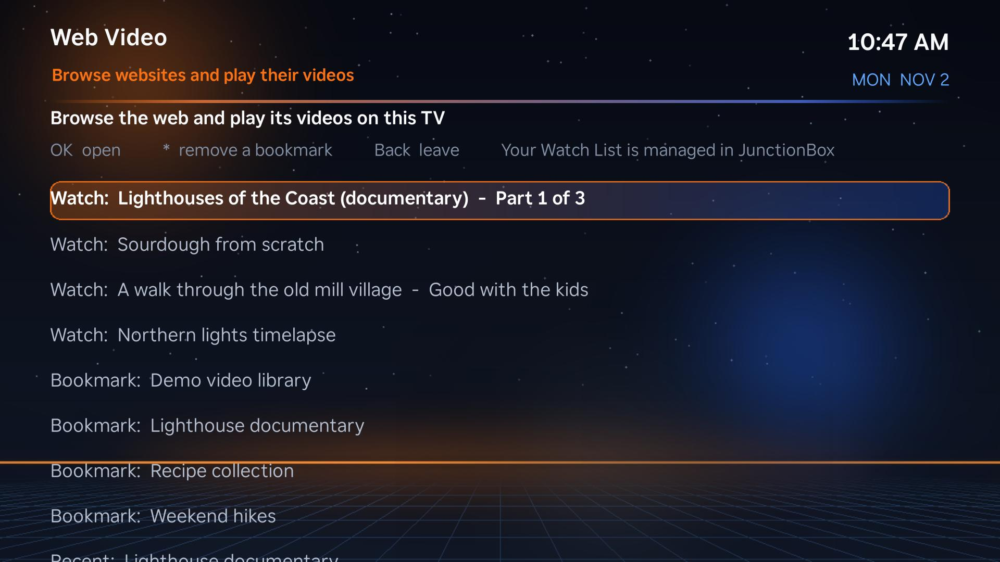


## Updating and removing

- **Updating**: install a newer `smart-tv-launcher.zip`, restart JunctionBox, then on the Smart TV Launcher page press **Update the bridge** (if offered) and **Update** on each TV.
- **Removing a TV**: **Remove** on its row. You'll be asked whether to also delete the launcher app from the TV.
- **Removing everything**: remove the TVs, press **Stop** on the bridge, delete the plugin, and delete the folder `~/.roku-launcher`. On Linux also run `systemctl --user disable --now roku-launcher-bridge`; on Windows also run `Stop-ScheduledTask JunctionBox-roku-launcher-bridge; Unregister-ScheduledTask JunctionBox-roku-launcher-bridge -Confirm:$false` in PowerShell; on macOS delete `~/Library/LaunchAgents/com.junctionbox.roku-launcher-bridge.plist`.

## Troubleshooting

| What you see | What to do |
|---|---|
| "Can't reach a Roku at that address" | Check the TV is on (not just standby), the address is right, and the computer and TV are on the same network. Some routers keep Wi-Fi devices on a separate "guest" network. |
| "Developer mode is off" | Redo the Roku steps in Step 1. After a factory reset, developer mode must be turned on again. |
| "The pairing code was wrong or has expired" | On the Google TV open **Pair device with pairing code** again for a fresh code and port, and type them in within a minute or two. |
| "Couldn't connect to the TV" (Google TV) | On the TV check Developer options, Wireless debugging is on. Turning it off and on again gives a new port, which the plugin finds by itself; if it still fails, pair again. |
| "The Roku rejected the developer password" | Use the webserver password from Step 1 (Roku). To change it, repeat Step 1 and choose a new one. |
| "Set up the bridge first" | Finish card 2 and wait for **Running**. |
| The TV app says it can't reach the bridge | The bridge must be running, and the TV must be able to reach this computer's address. If the computer has more than one network connection, open **Advanced** in card 4 and enter the address the TV should use, then press **Install** on each TV again. Also check that your computer's firewall allows incoming connections on the bridge's port (8791 by default). |
| Weather or tiles don't update | They refresh when the launcher opens. Check that the bridge is **Running**. |
| Ring or Home Control tiles say a secret isn't found | Set up that plugin (Ring Security or Home Control) in JunctionBox first, then reopen the tile. |
| Ring live view is missing | Install **Ring live view** and **ffmpeg** in card 2. |
| The launcher vanished from a TV after an update | The Roku refused the new app. The plugin shows the Roku's own message when you press **Install**; the bridge log (**Show log**) has more. |
| The TV keeps going back to the launcher | That's auto-return. Use **Settings, then Exit launcher** on the TV. |
| A box shell says the connection was refused or timed out | The box is off, asleep or on another network. Try it from this computer with `ssh` first. A box without a saved key or password asks for the password in the terminal itself. |
| Screen Share says it needs the Web Video part | Install **Web Video** in card 2 (it brings the browser Screen Share uses), then try again. |
| Screen Share says it couldn't find a graphical session | The box needs someone logged in at its desktop; JunctionBox can't share a box that is at a login screen with nobody signed in. The same message appears in the web app. |
| A terminal tile says the command was not found | Install that tool on the computer (Claude Code, Codex or Grok) and sign in to it there once. Card 6 shows which of the three were found. |
| "The terminal is off" | Set a terminal PIN on card 6 (it also unlocks Agents). |
| Agents shows no pop-ups | Pop-ups only go to the TV that started the chat, only after the PIN was entered on that TV, and not when they are off for that TV (Agents menu) or for every TV (card 6). |
| Recipes says the plugin isn't installed | Install **Recipes** from the Plugins page; the TV reads its recipes from there. |
| No video starts beside the recipe | Some pages wait for a click before they load a video. Open the page once in Web Video, or save a direct stream in Media Player. |
| An agent in Agents says it is inactive | Activate it on JunctionBox's Agents page; the TV uses the same agents. |
| "Wrong PIN" or "locked" | Five wrong tries lock all three terminals for five minutes. Wait, or set a new PIN on card 6. |
| "The terminal session timed out" | You were away for more than 15 minutes, or the bridge restarted. Open the tile again and enter the PIN. |
| A terminal ended straight away | Claude's first question about trusting the folder defaults to "No, exit". Open the tile again and press **Down** then **OK** to trust it. When an agent has ended, **OK** starts it again. |
| The Roku reads out every button | That is the Roku's Audio Guide, which pressing `*` four times in a row switches on. Turn it off in the Roku's Settings, Accessibility, Audio Guide. In the terminal press Back for the quick keys instead of `*`. |
| "Python 3.9 or newer ... is needed" | Install Python with `venv` support (see What you need), then press **Set up the bridge** again. |

The bridge's log is `~/.roku-launcher/bridge.log`; **Show log** displays the end of it.

## Privacy and safety

- The bridge listens on your home network only. Every request needs the private token; media links given to the TV are signed and short-lived.
- The Roku **developer password** is stored encrypted in the JunctionBox database. It's used only to install the launcher on your own TVs.
- The bridge reads your JunctionBox data folder read-only (photos, videos, books). It never writes to the JunctionBox database. For Home Control and Ring Security, JunctionBox hands the bridge each plugin's private secret in memory, over the local connection only, using a second token that never goes onto a TV.
- Anything your plugins mark as hidden stays hidden, and password-protected photo groups appear locked with nothing inside, on the TV too.
- The Agents tile lets a TV talk to your JunctionBox agents, which can act on your computer, so it uses the terminal PIN and the same lockout and idle limits, goes through JunctionBox's own run code (the agent's permissions apply), and only ever sends a pop-up to the TV that started the chat.
- The Claude, Codex and Grok terminals are a remote shell for the account that runs the bridge. They are off until you set a PIN, ask for it every time, lock after five wrong tries and sign out after 15 idle minutes; the PIN is stored only as a salted hash. Box shells reach every box you've added to JunctionBox with the credentials JunctionBox already holds for it, so a PIN holder has the same access to those boxes as you do from JunctionBox's own terminal. Each agent starts in the permission mode you chose on card 6, so a "do everything" mode means anyone with the PIN can act as you on that computer. Only use it on a network you trust.
- The Morning Briefing's calendar addresses are credentials: they are kept in `briefing-calendars.json` (mode 600) in the data folder, are never returned by any page or shown again, and are never written to a log. A market-data key is stored the same way and only ever reported as "saved". The briefing's files are served to a TV only through short-lived signed links, one folder per day, and never outside that day's folder.
- Don't expose the bridge's port to the internet.

## For developers

- The plugin source is `plugins/source/smart-tv-launcher/`: the plugin's own `backend/` and `frontend/`, plus `launcher/` with the Roku app (`launcher/app`, a SceneGraph/BrightScript app) and the bridge (`launcher/bridge`, Python standard library plus optional packages). `scripts/package-local-plugins.py` builds `plugins/packages/smart-tv-launcher.zip` from it.
- The app's source contains two placeholders, `__BRIDGE_URL__` and `__BRIDGE_TOKEN__`. The plugin fills them in when it builds the package for a TV, so neither the address nor the token is ever in the source or the zip. No third-party streaming logos are shipped: the bridge fetches each channel's icon from the TV that asks (`/tvicon/<id>`, cached for a week) and serves it to the launcher, because the Roku can't load pictures from its own control port.
- `launcher/android/` is the Google TV app (a small Java WebView shell). `build_apk.sh` builds `launcher.apk` with only the Android SDK command-line tools and a JDK, no Gradle. It signs with a key kept outside the repository (`~/.junctionbox/roku-launcher-android.keystore`): keep that key, because every update must be signed with the same one. `launcher/bridge/gtv/` holds the pages the app shows.
- `launcher/tools/make_assets.py` regenerates the artwork in `launcher/app/images` (needs Pillow).
- The terminals: `launcher/bridge/terminal.py` runs each agent or box shell in a pseudo-terminal (`pty`), keeps its screen and scrollback with `pyte`, and shares one PIN check and session key across agents. `launcher/bridge/terminal_modes.json` is the single list of each agent's permission modes (the page and the bridge both read it); the chosen modes are in `term-modes.json` and the PIN hash in `term-pin.json`, both in the data folder with mode 600. The Roku can't draw a monospace font from a Font node (it rendered nothing), so the bridge draws the screen as a PNG with Pillow and the bundled DejaVu Sans Mono (braille characters are drawn as dots) and the Roku shows it in two posters it swaps; the signed picture URL needs no header. Google TV draws the same screen as coloured text. `launcher/tools/make_term_tiles.py` draws the tiles.
- Bibles: `launcher/bridge/pdfbooks.py` renders PDF pages to pictures and reads the contents lists; `launcher/tools/make_bibles.py` builds the Bible PDFs and their contents from the bundled texts in `launcher/bibles` (seven `*.json.gz` plus `index.json`). Book Studio and Comic Studio write `<id>.toc.json` next to each book when it is built.
- Screenshots: the pictures in `docs/images/roku` are real screenshots of a Roku (the developer page's Screenshot tool gives a 1920x1080 picture of what the TV draws, and the Roku's remote-control port presses the buttons), taken with the demo data so nothing real appears. The tools, and how to run them, are in `launcher/tools/demo` (`README.md` there); `make_tv_mockups.py` makes the TV-framed and animated versions used on the website in `docs/images/roku/website`.
- Morning Briefing: the work is in the plugin's `backend/briefing_*.py`. `briefing_calendar`, `_weather`, `_news`, `_scripture` and `_markets` each fetch and check one kind of content (only what the sources returned, with dates, and a stated gap when a source fails); `briefing_script` lays it out as beats (a spoken paragraph plus a card) and sizes the news and scripture to the time left; `briefing_voice` (Kokoro in `~/.junctionbox/tts`, cached by text, voice and speed) and `briefing_render` (Pillow cards from `briefing_cards`, ffmpeg, captions, 1920x1080 at 30 fps, H.264 and AAC with the index at the front, verified after it is built) make the video; `briefing_clips` keeps the clip library and builds the slow looping beds; `briefing_engine` runs it all, writes each day to `~/.junctionbox/briefing/days/<date>/` (`manifest.json` is written last, so a TV never sees a half-made briefing), retries with a growing wait, and catches up after a restart. Settings are `briefing.json` in the data folder, validated by `briefing_config`. The bridge side is `launcher/bridge/briefing.py` (reads a day's folder, signs links, decides the once-a-day auto-play); the Roku screen is `BriefingScreen`, the Google TV page is `gtv/briefing.js`. The bridge's power-on watcher passes `contentId=briefing` when it launches the Roku app for a first turn-on.
- Tests: `cd plugins/source/smart-tv-launcher && PYTHONPATH=../../../backend pytest backend/tests/` (234 tests).
- Screen share: `launcher/bridge/screenshare.py` opens JunctionBox's existing screen sharing in a headless browser (Playwright) on `launcher/bridge/novnc/viewer.html` (noVNC 1.7.0 served to the browser from disk, never over the network), takes a JPEG of it a few times a second, crops and zooms it with Pillow, draws the pointer, and turns the TV's keys into mouse and keyboard events (mouse through the browser, keys through noVNC's `sendKey`). The plugin starts the session with JunctionBox's own `screen_share.start_screen_share` (`POST /api/plugins/smart-tv-launcher/mcp/share/start/{box}`, loopback only, bridge-only token, same throttle) and hands the viewer a one-time login for the socket; the bridge revokes that login the moment the socket is open, and the plugin will only revoke logins it handed out. The same PIN and session key as the terminals guard it, and the share ends when the TV stops asking for pictures.
- Box shells: the bridge never holds JunctionBox's master key, so for a box it asks the plugin (`GET /api/plugins/smart-tv-launcher/mcp/box/{id}`, loopback only, bridge-only token, same throttle as the secret route; a TV's own token is refused). The plugin decrypts the box's credentials, writes a private temporary key file (mode 600 under `~/.junctionbox/keys`) and returns the `ssh` command; a password goes in the `SSHPASS` environment variable, never on a command line. The bridge deletes the key file when the shell ends and sweeps any left by a crash when it starts. The picker reads only the box id, name, host and platform from the database; the credential columns are never selected. They use a throwaway database and data folder, and a fake Roku developer page that checks the digest login and package upload, and never touch your real TVs.
- Roku BrightScript notes learned the hard way: never name things `left`, `step` or `next`; a one-line `if ... then A : B` runs `B` regardless, so use multi-line `if`; a dialog hands focus back to whatever had it before, so call `setFocus(true)` on your screen after closing one; custom `Font` nodes can render nothing on a real device; a Task node already has a `state` field; `setFocus(true)` on a parent does nothing while a hidden child list still holds focus, so give a screen a dedicated focus node.

## Free and paid

The launcher is free. Only Claude, Codex and Grok, agents, terminals and screen sharing need a paid JunctionBox (Pro). Everything else (apps, books, game schedules, reminders, the morning briefing, cameras, recipes) stays free.

Every JunctionBox install starts with a 7-day trial of everything. When it ends and there is no license, those paid screens answer "The 7-day trial has ended" and the free ones carry on. The bridge asks JunctionBox (`GET /access`) and remembers the answer for a minute; if JunctionBox can't be reached the last answer stands. A license (Settings, License) ends the trial and unlocks everything for good.

**Pit Boss grill (2026-11-09).** A **Grill** tile (Roku and Google TV) shows the grill and probe temperatures, what the grill is doing and any error, refreshed every five seconds (`GrillScreen.brs`, `gtv/grill.js`, bridge `GET /grill/state`). The grills and each grill's alert settings belong to the Pit Boss Grill plugin; the bridge reads its `pitboss_grills` table read-only. `launcher/bridge/grillwatch.py` polls each grill that has an alert switched on every 15 seconds (JSON-RPC on the grill's port 80, read-only; the frame layout is the plugin's, pinned by a test) and raises each alert once: the grill reached its set temperature, a probe reached the temperature set for it, or the grill reports a problem (out of pellets, igniter, fan...). An alert goes through `reminders.push`, the same path as a reminder: the TVs are turned on (if the alert says so), show it full screen and speak it. What it has already announced is kept in `grill-alerts.json`, so a restart does not repeat it. The TV screen only shows; controls and alert settings are on the plugin's page. The Grill screen also has buttons: **Set temperature** (Left / Right through the temperatures the grill accepts, OK sets the nearest one it has), and **Turn off** or **Start** (each asks first; Start says it lights a fire and the bridge refuses it unless the TV confirmed and the grill is off). They go to the bridge's `POST /grill/cmd`, which loads the plugin's own `grill.py` for the command bytes and setpoint lists, so nothing is copied.
